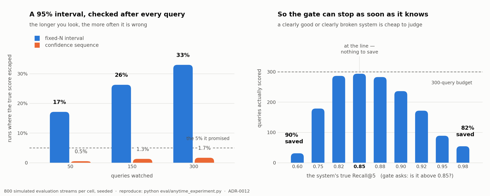
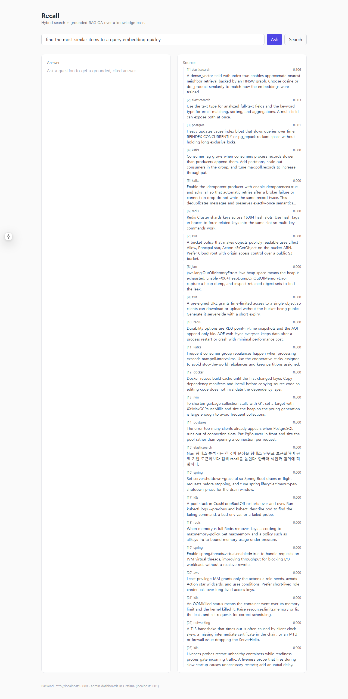
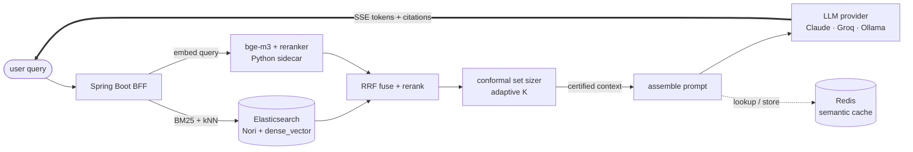
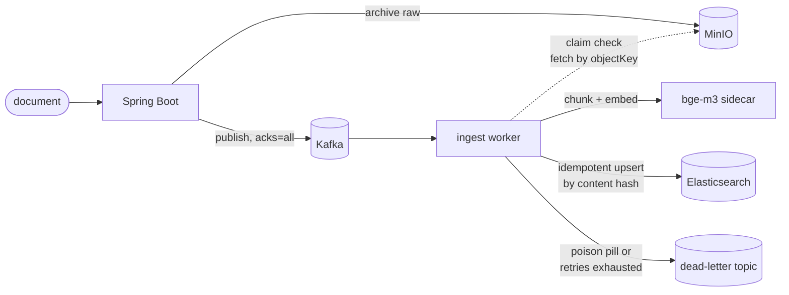
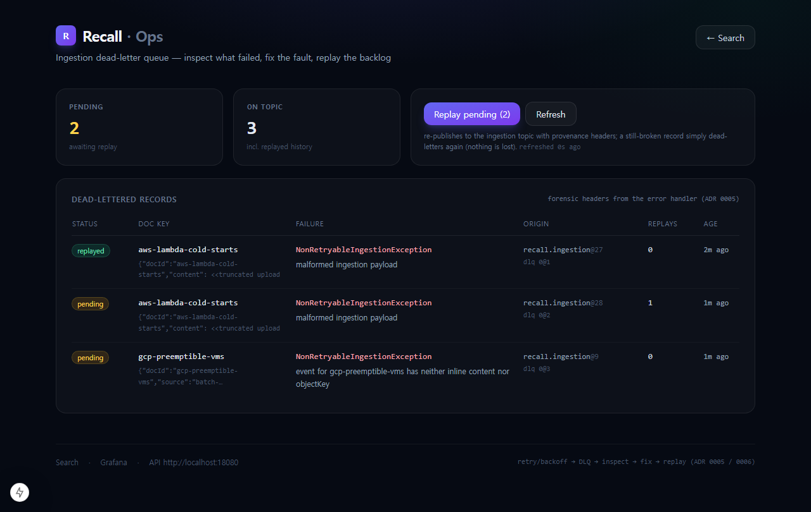

# Recall — 自らの主張を証明できる RAG システム

[English](README.md) · [한국어](README.ko.md) · **日本語** · [简体中文](README.zh-CN.md)

[](https://github.com/jinwovo/recall/actions/workflows/ci.yml)
[](https://github.com/jinwovo/recall/actions/workflows/eval.yml)

ハイブリッド(BM25 + 密ベクトル)検索と根拠に基づく RAG 質問応答を、バックエンドエンジニアリングの
問題として構築したプロジェクトです。そしてもう一度作り直しました。最初のバージョンの品質に関する主張が、
検証に耐えなかったからです。

**このリポジトリの大部分は、その検証についてのものです。** どの RAG システムも数字を出します —
`Recall@5 = 1.00`、`nDCG@10 = 0.96` — しかし、その数字を*主張*たらしめるものを一緒に出すシステムは
ほとんどありません。検証ツールをようやく書いたとき、最初にこのリポジトリ自身の README に向けたところ、
見出しの主張のうち 3 つが崩れました。

<picture>
  <source media="(prefers-color-scheme: dark)" srcset="docs/anytime-dark.png">
  
</picture>

---

## 監査

ゴールドセットは 10 クエリで、各クエリに関連文書がちょうど 1 つでした。つまり `Recall@5` はクエリごとの
コイン投げであり、公表された `1.00` は 10 回中 10 回成功したという意味です。ここから直ちに 3 つのことが
導かれますが、そのどれもリポジトリのどこにも書かれていませんでした。

| 主張 | 実際に言えること | 理由 |
|---|---|---|
| `Recall@5 = 1.00` | **`1.00`、95% CI `[0.69, 1.00]`** | 10/10 における正確な二項区間の下限は `(α/2)^(1/n) = 0.69`。幅 31 ポイントの数字が事実として提示されていました。 |
| 「ハイブリッドは BM25 より Recall@5 を **+0.30** 上げる」 | **p = 0.25 — しかも 0.25 はこの比較が返しうる最良の p** | 10 クエリ中 7 つが同点で、異なるのは 3 つだけ。3 組の対応検定の p 値の下限は `2/2³`。「有意でない」のではなく、有意に*なりえない*。 |
| 夜間チューナーが **+0.01 MRR** の改善で設定をデプロイ | **0.01 を判別するには約 7,000 クエリが必要** | 10 クエリでグリッド 9 点を探索して argmax を取り、選択に使ったのと同じ 10 クエリで採点するゲートが検証していました。 |

```console
$ make eval-stats          # no stack, no network — this is a property of the labels

At least 6 of 10 queries must differ before any outcome can be significant.

    observed      95% interval   width
1.00 (10/10)  [0.692, 1.000]   0.308
 0.70 (7/10)  [0.348, 0.933]   0.586

A tuning loop that acts on a difference smaller than the smallest detectable effect
is not tuning — it is resampling noise.
```

システムは設計されていましたが、測定は設計されていませんでした。以下は 2 つ目のバージョンです。

---

## 保証になった 5 つのこと

### 1. 見ている間も有効であり続ける評価

95% 区間が約束するのは、**完了した**標本を**一度**見たときに 95% の確率で真値を含むということです。
クエリごとに再計算され、ストリーミング中に見続けられる区間については何も約束しません — しかし、あらゆる
CI 実行は実際にそうやって読まれています。セルごとに 800 本のシミュレーション評価ストリームで測定し、
固定標本区間には最大限有利になるよう、正規近似が正当化される n = 30 から見始めるようにしました。

| 指標 | クエリ数 | 固定標本区間 | 信頼系列 |
|---|:---:|:---:|:---:|
| Recall@5 (0/1) | 300 | **34.0%** | 1.9% |
| reciprocal rank(離散、偏り) | 300 | **32.8%** | 2.6% |
| nDCG@10(段階評価) | 300 | **35.1%** | 1.6% |
| groundedness judge(高い方に偏り) | 300 | **30.0%** | 0.5% |

*見ている途中のどこかの時点で、真の平均が名目 95% 区間の外に出た実行の割合。* 固定標本の列はストリームが
長くなるほど大きくなります — 長く見るほど間違える機会が増えるためで、これは重複対数の法則の特徴であり、
シミュレーションが正しく動いている兆候です。

解決策は**信頼系列(confidence sequence)** です。すべての標本サイズで同時に有効な区間で、
[Waudby-Smith & Ramdas (JRSS-B, 2024)] のヘッジ付き資本過程として構成します。次の観測ごとに仮説が示唆する
オッズで賭けると、帰無仮説の下で資産は非負のマルチンゲールとなり、Ville の不等式がそれが `1/α` を超える
確率を抑えます。検索指標はこれに非常によく合います — reciprocal rank、nDCG、recall、judge のスコアは
すべて `[0, 1]` に収まり、形状について何も仮定しません。

これにより早期停止は p ハッキングではなく正当な手続きとなり、ゲートは実際にそうします。

```bash
make eval-gate GATE_POLICY=sequential
```

| システムの真の Recall@5 | ゲート判定 | 採点したクエリ(300 中) | 削減 |
|:---:|:---:|:---:|:---:|
| 0.98 | 合格 | 54 | **82%** |
| 0.95 | 合格 | 89 | **70%** |
| 0.85(ちょうど基準線) | `undecided` | 293 | 2% |
| 0.60 | 不合格 | 31 | **90%** |

実際の API に対して 200 クエリで: 健全なシステムは **69 リクエスト**で合格し、壊れたシステムは **13** で
不合格になりました。削減されるのはレポート上の小さな数字ではなく、送らずに済んだ HTTP 呼び出しと使わずに
済んだ LLM judge のトークンです。`undecided` はゲートを不合格にします — 「判断できなかった」を合格として
扱うゲートは、静かにゲートであることをやめています。

→ [ADR 0012](docs/adr/0012-anytime-valid-evaluation.md) · `make eval-anytime` で両方の表をゼロから再現
できます(シード固定、スタック不要)。

### 2. 推測ではなく較正されたコンテキストサイズと回答拒否

2 つの定数が、このシステムのコストとハルシネーションの頻度を決めていました。

```yaml
recall.retrieval.top-k: 8                            # passages that reach the LLM
recall.rag.sufficiency.confidence-threshold: 0.35    # when to answer at all
```

固定の top-K は両方向に同時に間違っています。reranker が明らかに正しい passage を 1 つ見つけたクエリでは、
残り 7 つはノイズに使うプロンプトトークンです。スコアが平坦な曖昧なクエリでは、同じ K が答えを含む
passage を切り捨て — 後段のどこもそれを報告しないため、生成は答えを支えられないコンテキストから進みます。

今ではどちらも**有限標本・分布非依存の保証を持つ較正済み閾値**です。スコア分布についての仮定も、漸近論も、
reranker がよく較正されているという要件もありません。

```
coverage   P(the passages sent to the LLM contain a relevant document)  >= 1 - alpha
risk       P( P(answering from context with no relevant document) <= risk-alpha ) >= 1 - delta
```

前者は適応的な集合サイズを使う分割 conformal 予測([Romano, Sesia & Candès, NeurIPS 2020])、後者は固定順序
検定を使うリスク制御予測集合([Bates et al., JACM 2021])です。`make calibrate` はゴールドセットを 1 回
走査するだけで両方を作ります — `Recall@5` を採点する検索が、関連文書が何位にあったかと reranker の確信度を
すでに記録しており、どちらもそれだけあれば十分です。

1 回の実行、800 クエリ、`alpha = 0.10`、[`eval/_mock_reranker.py`](eval/_mock_reranker.py) の代替
cross-encoder に対して — そのためスタックなしで再現でき、`make calibrate` は本物に対して同じことを行います。
分割: チューニング 192 / 較正 288 / ホールドアウト 320。

| ホールドアウト分割で | 固定 K *(conformal — 同じ約束)* | 適応的 |
|---|:---:|:---:|
| LLM に送った passage 数 | 9.0 | **5.0** |
| カバレッジ | 91.9% | 90.2% `[86.3, 93.4]` |
| 正解が 1 位だったとき | 9 passage | **3.2 passage** |
| 正解が 4 位以下だったとき | 9 passage | **8.4 passage** |

**同じ保証でプロンプトトークン 44% 削減**です。予算がようやく必要な場所へ移動できるようになったからです。
何も学習していない reranker でも保証は壊れません — その代償をコンテキスト長で払うだけで、これは分布非依存
という性質が役目を果たしている姿です。

同じ実行のリスク証明書は**拒否され、その理由を述べます**。証明できる最も寛容な閾値がすべてに回答拒否する
閾値なので、出荷されずに degenerate とラベル付けされます。探索は `0.98` で止まりました。そこでは観測リスク
2.8% で回答でき、5% の目標を下回りますが、それを*証明*するには手元の 288 ではなく約 487 の較正クエリが
必要です。解決策はより多くのデータであって、より緩い目標ではありません。

サービング経路は Java で較正器は Python ですが、保証は*ひとつの*手続きの性質です。サービングが較正の
前提と異なる K を計算すれば、`alpha` には何の意味もありません。
[`ConformalSetSizerTest`](backend/src/test/java/com/portfolio/recall/rag/ConformalSetSizerTest.java) は
24 個のゴールデンベクトルで両者を固定しており、各ベクトルは包含境界から少なくとも `1e-9` 離れるように
選んであるため、2 つの `exp` 実装の最終 ulp の差が答えを反転させることはありません。

デフォルトは**無効**です。`make calibrate` が証明書を作るまで、パイプラインは固定の top-K を維持します —
`[0, 1]` の外の閾値は保守的なのではなく、未設定なのです。

→ [ADR 0013](docs/adr/0013-conformal-risk-control.md)

### 3. 初めて人間と照合された LLM judge

`groundedness = 0.81` は、CHEAP 階層のモデルが自分の属するシステムが作った回答について述べた意見です。
その judge が 8 ポイント楽観的なら、公表された数字は 8 ポイント間違っており、パイプラインの何も気づき
ません — 上の区間の仕組みは、間違った値の周りに狭い区間を忠実に報告するでしょう。あらゆる RAG システムが
この問題を抱えており、規模が大きくなれば大規模ゴールドセットの*関連性*ラベルも同様です。

**予測駆動推論(prediction-powered inference)** ([Angelopoulos et al., *Science* 2023][ppi]; PPI++ として
検出力を調整)が出口です。小さな標本に手でラベルを付け、judge にすべてを採点させ、ラベル付き部分で測った
バイアスを差し引きます。

```
theta = mean(hand labels) + lambda x ( mean_unlabelled(judge) - mean_labelled(judge) )
```

行ごとにラベル付け・推定のサイクル全体を 1,500 回繰り返し、手ラベル 50 個対 judge 採点 2,050 個で、
真値が正確に分かっている量を推定しました。

| judge の振る舞い | judge のみ | 手ラベルのみ | **PPI** | PPI 区間幅 | 有効ラベル数 *(50 から)* |
|---|:---:|:---:|:---:|:---:|:---:|
| お世辞的だが正確 | **0.0%** | 94.0% | **94.3%** | −67% | **474** |
| お世辞的でノイズ大 | **0.0%** | 94.2% | **93.5%** | −22% | 84 |
| 偏りなしだがノイズ大 | 14.5% | 94.7% | **93.7%** | −22% | 85 |
| 情報なし | **0.0%** | 94.8% | **94.3%** | −1% | 51 |

*最初の 3 列: 各手法が公表した 95% 区間が実際に真値を含んだ頻度。* 数千の judge スコアを平均することは
95% 区間ではありません — judge が信じている値の周りの非常に狭い区間であり、judge が偏っていれば事実上
決して正しくありません。「偏りのない」judge でさえ失敗します。`[0, 1]` にクリップされたスコアは境界付近で
バイアスを持つからです。

2 つの性質がこのコードを書く価値のあるものにしています。**妥当性は judge が良いことに決して依存しません**
— バイアスは仮定されるのではなく測定されます。そして**役に立たない judge はコストになりません**: λ は分散を
最小化するように調整されるので、ノイズを予測する judge は λ ≈ 0 となり、推定量は手ラベルの平均に収束
します。最下行はその安全性が機能している姿です。

```console
$ python run_qa_eval.py gold.jsonl --human-labels judge-labels.jsonl

judge alone      0.886   (no validity — the judge's opinion of its own system)
hand labels only 0.625   [0.156, 1.094]  n=4
PPI              0.637   [0.341, 0.934]  lambda=1.00
judge bias       +0.250  (optimistic)
effective labels 10      (from 4 actually written)
```

**このリポジトリはまだそのラベルを書いていません。** そのため下の `0.81` は測定値ではなく judge の意見と
して示されています。仕組み、ファイル形式、拒否経路はすべて同梱されており、残っているのは研究プロジェクト
ではなく数時間の手作業の採点です。

→ [ADR 0015](docs/adr/0015-prediction-powered-inference.md) · `python eval/ppi_experiment.py` で表を
再現します。

### 4. ハーネスが実際に判別できるベンチマーク

上のすべてのツールが同じ結論に達し続けたので:

```bash
make beir              # SciFact: 5,183 documents, 300 queries, binary qrels
make beir-eval         # ingest through the real pipeline, then evaluate
```

[BEIR](https://github.com/beir-cellar/beir) (Thakur et al., NeurIPS 2021 D&B) をこのリポジトリのコーパス・
ゴールド形式で、標準ライブラリだけで取り込みます — `datasets` も pyarrow も、インストールするものはあり
ません。SciFact がデフォルトなのは判定が**二値**だからで、このリポジトリの二値ゲイン `nDCG@10` が公表された
`nDCG@10` と同じ意味を持ちます。段階評価のデータセットでは判定を二値化する必要があり、得られる nDCG は比較
*できません*。ツールは読者が別の前提を置かないよう、この警告を出力します。

ダウンロードとともに設計分析が出てきますが、耳当たりの良い内容ではありません。

```
smallest attainable p   9.82e-91   (against 2.0e-01 on a 10-query set)
dMRR@10 = 0.02 at sd 0.30 needs 1,766 queries -> short by 1,466
```

分解能は 30 倍になりましたが、2 ポイントの MRR 変化を決着させるにはまだ足りません。後で気づくより出力して
おく方がよいでしょう。

**SciFact の測定結果。** 実際のパイプライン — Kafka、チャンキング、bge-m3、Elasticsearch — で 5,183 文書を
インデックスし、アイドル状態のマシンで 300 クエリを二値 qrels に対して評価しました。

| モード | Recall@5 | Recall@10 | MRR@10 | nDCG@10 |
|---|:---:|:---:|:---:|:---:|
| bm25 | 0.725 <sub>[0.67, 0.77]</sub> | 0.769 <sub>[0.72, 0.81]</sub> | 0.639 <sub>[0.59, 0.69]</sub> | 0.666 <sub>[0.62, 0.71]</sub> |
| vector | 0.740 <sub>[0.69, 0.79]</sub> | 0.788 <sub>[0.74, 0.83]</sub> | 0.615 <sub>[0.57, 0.66]</sub> | 0.650 <sub>[0.61, 0.69]</sub> |
| **hybrid** | **0.802** <sub>[0.76, 0.84]</sub> | **0.844** <sub>[0.80, 0.88]</sub> | **0.704** <sub>[0.66, 0.75]</sub> | **0.734** <sub>[0.69, 0.77]</sub> |

**まず BM25 の行を読んでください。** BEIR 自身が SciFact について報告する BM25 ベースライン約 0.665 に対し、
`nDCG@10 = 0.666` となりました — これは、経路全体が正しいことの外部チェックとしてこのリポジトリが持つ最も
近いものです。チャンキング、アナライザ、ES マッピング、チャンクから文書への重複排除、採点コードがすべて
公表された設定と一致して初めてその値になり、どれか 1 つでも間違っていれば値は動いていたはずです。

そのベースラインに対して `hybrid` はすべての指標で上回り、指標ごとに Holm 補正した対応ランダム化検定で
差は有意です(`nDCG@10` +0.068、Holm p = 0.0002)。**`vector` 単体はそうではありません** — recall では
ノイズの範囲内で、順位に敏感な指標では BM25 よりわずかに*劣ります*(`MRR@10` −0.025、Holm p = 0.25)。
ここでは密検索は単独では BM25 に勝てません。利得は実際には融合と再ランキングから来ており、これこそ
アーキテクチャが依拠する主張であり、今では仮定ではなく測定された事実です。

ゴールドセットはこの比較に十分な検出力を持ち、自らそう述べます: 300 クエリは検出力 80% で `MRR@10` の効果
+0.051 を判別でき、測定された効果は +0.065 です。2 ポイントの変化に対しては検出力が*なく* — 1,918 クエリが
必要です — `power_report.py` は両方を出力します。

全表、クエリごとの最初のヒット順位、ブートストラップ区間: [`docs/beir-summary.md`](docs/beir-summary.md) と
[`docs/beir-results.json`](docs/beir-results.json)、`make beir-eval` で再生成されます。そのコスト —
そして最初の実行がそれについて誤っていた訂正と落とし穴 — は[ベンチマーク手順書](docs/BENCHMARK-RUNBOOK.md)に
あります。まず、この実行は再ランキングのレイテンシが示唆する数分ではなく、ノート PC の CPU で約 14 時間
かかる作業です。

→ [ADR 0014](docs/adr/0014-beir-benchmark-scale.md)

### 5. 2 の証明書は失効する。そして今ではシステムがそう告げる

2 節上のあの閾値は、有効数字 18 桁が、その近くのどこにも書かれていない仮定の上に立っています。較正に使った
クエリとサービングするクエリが同じ分布から来なければならない、という仮定です。生きたコーパスは 1 週間で
これを壊します — 文書が取り込まれ、クエリの構成が変わり、誰かが埋め込みモデルを入れ替える — そしてその
失敗は静かです。設定は変わらず、ダッシュボードは緑で、約束はもはや真ではありません。

水準(level)は、実現したミスカバレッジによって駆動される制御変数になります(Gibbs & Candès, NeurIPS 2021)。
更新を合計すると正確な恒等式に畳み込まれ、`alpha_t` は `[-gamma, 1+gamma]` から逃れられないため、長期の
カバレッジは**いかなる分布の仮定もなしに**目標へ収束します — 交換可能性も、定常性も、変化が敵対的ではなく
ランダムであることさえも必要ありません。

ストリーム 200 本、各 3,000 クエリ、約束 90%:

| シナリオ | 固定閾値 | ローリングウィンドウ | 適応的 |
|---|---|---|---|
| 位置シフト (+0.30) | 0.459 | 0.876 | **0.900** |
| スコア飽和 | 0.306 | 0.939 | **0.903** |

**興味深いのは中央の列で、私が探しに行った結果ではありません。** 単純な位置シフトに対しては、ローリング
ウィンドウが事実上すべての仕事を単独でこなします — 分位点がデータとともに動き、制御器はシフトを見ることすら
ありません。テストはこれを恒等式として固定しています: 0.00、0.20、0.30 のシフトにわたって、水準が目標から
最も離れた幅は*同じ* 0.100 です。この節の以前の草稿は、制御器がそこでドリフトを捉えていると主張して
いました。そうではなく、証拠に見えた数字はテスト生成器がスコアを 1.0 でクリップしたことによる人工物でした。

制御器が実際に担うのは、残差と、ウィンドウが追跡できないケースです。ウィンドウはうまく機能するときでも
系統的にずれます — 87.6% でカバー不足になり、飽和下では 93.9% で*過剰*カバーしますが、これは安全ではなく、
保証が必要とするより大きな集合に使われるプロンプトトークンです。そして候補の大半が同点の最高スコア 1 つに
集まると、どのローリング分位点もそれらを分けられません。ずらした水準だけがカバレッジを保ち、それがシグナル
の名前が `drifting` ではなく `compensating` である理由です。ウィンドウが吸収するシフトでは False のまま
(0/60)で、飽和するすべてのストリームで発火します(60/60)。

**そしてサービング経路がそれを声に出して言います。** `CoverageMonitor`(Java)は groundedness judge を
カバレッジのシグナルとして配備された証明書を監視し、約束された率が*排除*された時点で警告します — 35% を
外すストリームで 43 クエリ目に。これは anytime-valid でなければならず、ここで 1 が元を取ります。この
ストリームはクエリごとに検査され、まさにその方式で固定標本区間が 30〜35% の確率で外れることが測定されて
います。ここで二項検定を使えば毎週のように誤報を出すでしょう。

アラームは片側です。約束より*良く*カバーしているシステムは保守的な手法の普通の状態であって、障害ではない
からです — 過剰カバレッジはトークンコストのゲージであり、呼び出しの対象ではありません。コードが隠さずに
述べる 2 つの注意点があります。judge は偏った計器なので(3)、これは真値ではなく judge のミスカバレッジで
あり、judge は回答拒否とキャッシュヒットをスキップするので、トラフィックの部分母集団を監視しています。
温度計ではなく煙感知器です。制御器そのものはオフラインのままです — クエリごとに非適合スコアが必要ですが、
サービングにはそれを計算するゴールドラベルがありません。それでも出荷すれば、保証の入っていない保証の形を
した物になるでしょう。

→ [ADR 0016](docs/adr/0016-adaptive-conformal-drift.md) · `python eval/adaptive_experiment.py` で表を
再現します。

### 次へ: 回答そのものの文に対する保証

上のすべては回答*以前*の段階 — コンテキスト、回答するかどうかの判断、judge — を証明します。そのどれも、
回答のどの文が真かを述べません。groundedness judge は回答全体を採点するため、でっち上げの主張 1 つは、良い
主張 5 つと一緒に出荷されるか、それらを道連れにします。

[ADR 0017](docs/adr/0017-claim-level-conformal-factuality.md) は証明書を claim 単位に移します(Mohri &
Hashimoto, ICML 2024; Conformal-RAG, SIGIR 2025)。各 claim を検索された passage に対して採点し、conformal に
較正された閾値を下回るものを除くと、

```
P( every claim left in the answer is supported ) >= 1 - alpha
```

シミュレーション(`make eval-factuality`、α = 0.10)では、フィルタなしの回答が完全に裏付けられるのは
**38%** で、フィルタ後は **90.0%**、真の claim の 88% を保持します。ドメインごとに較正すると、難しい
グループは 82% から約束された 90% に上がります。そしてこの手法に対する 2026 年の監査
([arXiv 2603.16817](https://arxiv.org/abs/2603.16817))が見つけた限界も、隠さずに再現しています。偽の
claim を含意されているように見せる妨害 passage は、これを **52%** に落とします。これはシミュレートされた
採点器上での手続きの性質です。

サービングでも動作します(`recall.rag.factuality.enabled`)。完成した回答の各文を、LLM が見た passage に
対して cross-encoder で judge と並行して採点し、閾値以下の claim は削除せず**その場で取り消し線を引きます**
— 読者はどの文に裏付けがなかったかを見られます。保留された claim を含む回答は決してキャッシュされません。
較正前(`threshold: -1`)は observe モードです。claim を採点して報告しますが何も保留せず、そのスコアと
claim ごとの人によるラベルを `python eval/factuality.py labels.jsonl` が貼り付けるべき閾値に変換します。
そのラベル付きセットはまだ存在しないため、出荷される閾値もありません。存在するようになれば、証明書は
カバレッジ(5)と同じ anytime-valid な失効アラームを受け、judge の判定は回答全体ではなく読者に残された
テキストに対するものになります — 回答全体を判定すると、フィルタが取り除いた claim のせいでフィルタを
責めることになるからです。

### そして今度はチューナーも自らを証明しなければならない

夜間の探索は層化された開発用分割を探索し、提案は 4 つのガードを通過しなければなりません — 効果量の下限、
グリッド全体に対する Holm 補正済みの対応ランダム化検定、そして**探索が一度も触れていないホールドアウト分割**
でも改善が見られること。開発とホールドアウトの差は、探索が持ち込んだ過学習として出力されます。データ不足で
ガードが失敗した場合、レポートはより小さな epsilon を勧める代わりに、決着をつけるのに必要なクエリ数を
示します。

同梱の 10 クエリのゴールドセットでは、事実上決して発火しないということです。それが正しい振る舞いです。
→ [ADR 0011](docs/adr/0011-statistical-inference-eval.md)

---

## 自分のリポジトリで eval ゲートを使う

上のすべてはこのシステム固有のものではないので、単体で利用できます。

```bash
pip install retrieval-eval-gate       # `rag-eval-gate` on PyPI is an unrelated project
rag-eval-gate power gold.jsonl        # what your gold set can resolve, before anything runs
rag-eval-gate audit -n 10 -v 1.00 -b 0.70    # or audit a published table, with no data at all
```

何もインストール不要なブラウザ版もあります:
**[jinwovo.github.io/rag-eval-gate](https://jinwovo.github.io/rag-eval-gate/)**。

→ **[jinwovo/rag-eval-gate](https://github.com/jinwovo/rag-eval-gate)** — 依存ゼロで、このリポジトリ自身の
ハーネスと違ってバックエンドを選びません。フィールドマップ付きの HTTP URL テンプレート、stdout に JSON を
出力するコマンド(そのため検索器の言語は問いません)、あるいは TREC run ファイル(そのためコーパスを
オフラインで一度ランク付けし、何も動かさずに評価できます)を受け付けます。ゴールドセットは JSONL または
TREC qrels です。

```yaml
- uses: jinwovo/rag-eval-gate@v0
  with:
    gold-file: eval/gold.jsonl
    url-template: 'http://localhost:8080/api/search?q={query}&mode={mode}'
    gate-policy: sequential            # point | ci-lower | regression | sequential
    min-mrr10: "0.85"
```

このリポジトリはツリー内ゲート用に独自のベンダリングコピーを保持しています。それは Kafka パイプライン経由で
コーパスを投入し、非同期インデックスが収束するまで待つこともします — 汎用ツールが知るべきではないことです。

```yaml
- uses: jinwovo/recall/.github/actions/rag-eval-gate@main
  with:
    api-url: http://localhost:8080
    gold-file: eval/gold.jsonl
    corpus-file: eval/corpus.jsonl     # seed + wait for async indexing first
    gate-policy: sequential
```

いずれの場合も、すべての指標の 95% 区間、Holm 補正でベースラインに対して有意性検定された各モード、ゴールド
セットがそもそも何を判別できるかの記述、そしてステップサマリーの `✅ PASS` / `❌ FAIL` が得られます。
私たち自身の eval ワークフローがツリー内アクションを使っています — ドッグフーディングが互換性テストです。

| `gate-policy` | 失敗する条件 | 使うとき |
|---|---|---|
| `point` *(デフォルト)* | 平均が閾値を下回る | 常に — 絶対的な下限 |
| `ci-lower` | 95% 下限が閾値を下回る | ゴールドセットが大きく、区間が安全マージンより狭いとき |
| `regression` | *さらに*記録済みの実行に対して有意な対応のある低下 | 比較対象の緑のベースラインがあるとき |
| `sequential` | anytime-valid な判定が `fail`、または予算が `undecided` で尽きる | クエリにお金や時間がかかるとき |

`regression` が敏感なポリシーです。絶対閾値は平均が誰かの推測した線を越えて初めて回帰に気づきますが、
対応のある検定は*同じクエリ*を前後で比較するため、平均がまだ線を上回っているうちに 2 クエリでの実際の低下を
捉えます。

## eval ハーネスは本番コードと同様にテストされている

実際に本番コードだからです。nDCG の計算が間違っていれば下流のすべての数字が間違い、ビルドの他の何もそう
言いません。

```bash
make eval-test     # 267 tests, standard library only, no stack, ~90s
```

- **閉形式** — `k = n` での `(α/2)^(1/n)`、一様な改善に対する `2^(1-k)`、R の `p.adjust` の例題、`(n+1)`
  の conformal 分位点補正。
- **独立実装** — テスト内に別途書いた総当たりの順列参照実装、SciPy がなければスキップする SciPy クロス
  チェック。
- **シミュレーションによる保証** — 較正→配備のサイクルを繰り返し、各約束が実際にどれだけ破れるかを数えます。
  偏った母集団に対する BCa のカバレッジ、連続検査下の信頼系列のカバレッジ、学習に使っていないデータでの
  conformal カバレッジ、リスク証明書の第一種過誤、意図的に偏らせた judge に対する PPI のカバレッジ —
  陰性対照とともに。推定量は、それが置き換えるものが明らかに失敗するときにだけ興味深いからです。
- **ハーネスのエンドツーエンド** — 指標を手で導出できるスタブ検索バックエンドに対して、4 つのゲートポリシー
  すべてを両方の結果に追い込み、逐次ポリシーの削減が実際に送られなかったリクエストであることを確認します。

これに加えて、バックエンドの単体テスト 117 個と、実際の ES、Kafka、MinIO に対する Testcontainers 統合
テストスイート 3 つがあります。

---

## デモ

根拠に基づく RAG QA、ライブ(4 倍速) — **英語コーパスに対する韓国語の質問**(bge-m3 による言語横断検索)。
パイプラインのステップ表示が **retrieve → generate → verify** を追う間、回答はインラインの `[n]` 引用付きで
トークンごとにストリーミングされます。**grounded** バッジは事後 LLM judge の判定(ADR 0004)で、引用を
クリックすると引用元が強調表示されます。生成は無料のローカル LLM(Ollama、CPU)です。


ハイブリッド検索画面 — 検索モード切替(hybrid / bm25 / vector)、ソースごとのスコアバー、クライアント側で
計測したレイテンシ:



## クイックスタート

**約 5 分で自分で動かせます。** API キーは不要です(Ollama による無料のローカル LLM)。

```bash
cp .env.example .env                 # optional: ANTHROPIC_API_KEY, or use free Ollama
docker compose up -d                 # ES (Nori), Redis, Postgres, Kafka, MinIO, sidecar, Grafana
cd backend && ./gradlew bootRun      # wrapper is committed; a JDK 21 is all you need
cd frontend && npm install && npm run dev      # http://localhost:3000

python scripts/seed_corpus.py                  # ingest the eval corpus (waits for indexing)
make eval-gate                                 # bm25 vs vector vs hybrid, with intervals
```

自分のコーパス用のセルフホスト型ハイブリッド検索 / RAG スターターとして使う:

```bash
python scripts/ingest_folder.py ~/my-docs      # .md / .txt / .html (+ .pdf with pypdf)
```

すべてのファイルは実際のパイプライン — Kafka、チャンキング、埋め込み、冪等な upsert、ADR 0005 の永続性
契約 — を通り、コマンドはすべてが実際に検索可能になるまで待ちます。再実行が同期の仕組みです。

[`mcp-server/`](mcp-server/) は `recall_search` と `recall_ask` を Model Context Protocol で公開するので、
自分の文書が Claude Desktop / Claude Code のエージェントツールになります。引用と groundedness 判定も含まれ
ます。

## アーキテクチャ

クエリ / RAG 経路:



取り込み経路 — 非同期、冪等、欠損なし(リトライ/バックオフ → DLQ、大きな文書は claim-check パターンで
MinIO 参照として運ぶ):



コンポーネントの詳細は [`docs/ARCHITECTURE.md`](docs/ARCHITECTURE.md) にあります。

## 検索品質

稼働中のスタックで、24 文書のコーパスと 10 クエリのゴールドセット(完全一致の用語、言い換え、韓国語の言語
横断)を使い、BBQ 量子化インデックスに対して測定しました。文書レベルの指標で、チャンクのヒットは最初の出現で
重複排除しています。

| モード | Recall@5 | 95% CI | MRR@10 | nDCG@10 |
|---|:---:|:---:|:---:|:---:|
| BM25 のみ | 0.70 | `[0.35, 0.93]` | 0.67 | 0.70 |
| ベクトルのみ | 1.00 | `[0.69, 1.00]` | 0.90 | 0.93 |
| **hybrid (RRF + cross-encoder)** | **1.00** | `[0.69, 1.00]` | **0.95** | **0.96** |
| hybrid、`rerank=m3`(3 モードのセルフハイブリッド) | 1.00 | `[0.69, 1.00]` | 0.90 | 0.93 |
| `mode=hyde`(仮想文書 kNN、再ランキングなし) | 0.90 | `[0.56, 1.00]` | 0.80 | 0.85 |

**この表は上の監査が言う通りに読んでください。** Recall の区間は報告された値から正確に導かれます — クエリ
ごとに関連文書が 1 つなので、各値は 10 回中の成功回数です — そして区間が広いのはシステムが不安定だからでは
なく、10 クエリが小さな標本だからです。MRR と nDCG の列は点推定で、`run_eval.py --json` を再実行すれば
ブートストラップ区間が得られます。BM25 から hybrid への順序は一貫しており意外性はありません — 完全一致の
用語クエリは BM25 に有利で、言い換えと韓国語のクエリは密ベクトルに有利、韓国語クエリ 2 つはどちらも BM25 が
外したものを hybrid が 1 位にしています — しかし差の*大きさ*はこの標本サイズでは判別できず、それが
`make beir` の存在理由です。

ここでは量子化は品質に中立です。float32 インデックスで同じ探索をすると、すべての密モードで ±0.02 以内でした。

### 論文に基づく手法

すべての検索段階は出典を示しており、いずれも同じ方法で採用されました。実装し、eval ハーネスで探索し、数字を
公開する。

| 手法 | 論文 | このリポジトリでは |
|---|---|---|
| Reciprocal Rank Fusion | Cormack et al., SIGIR 2009 | BM25 + kNN の融合 (`rrf-k=60`) |
| 多言語密検索 + cross-encoder 再ランキング | BGE / bge-reranker-v2-m3, Chen et al. 2024 | 埋め込みサイドカー、デフォルトの再ランキング |
| M3 3 モードのセルフハイブリッド (dense + sparse + ColBERT) | *BGE M3-Embedding*, Chen et al. 2024 | `?rerank=m3` — 埋め込みモデル自身のヘッド、追加モデルなし |
| HyDE(仮想文書埋め込み) | Gao et al., ACL 2023 | `?mode=hyde`、失敗時はベクトル検索に fail-open |
| 十分なコンテキストのゲート | Joren et al., **ICLR 2025** | 生成前の自動評価器、PRIMARY 呼び出しの前に回答拒否 |
| RaBitQ 1 ビット量子化 (ES **BBQ**) | Gao & Long, **SIGMOD 2024** | `bbq_hnsw` + オーバーサンプリング再採点、ベクトルメモリ約 32 分の 1 |
| **IR のための対応ランダム化検定** | Smucker, Allan & Carterette, CIKM 2007 | モード比較、Holm 補正 |
| **賭けに基づく信頼系列** | Waudby-Smith & Ramdas, **JRSS-B 2024** | 逐次ゲート |
| **Conformal 予測、適応的集合** | Romano, Sesia & Candès, NeurIPS 2020 | 適応的コンテキストサイズ |
| **リスク制御予測集合** | Bates, Angelopoulos, Lei, Malik & Jordan, **JACM 2021** | 較正済みの回答拒否 |
| **予測駆動推論** | Angelopoulos, Bates, Fannjiang, Jordan & Zrnic, **Science 2023** | 偏った judge から真の groundedness の有効な区間 |
| **BEIR** | Thakur et al., NeurIPS 2021 D&B | `make beir` |

GraphRAG / RAPTOR と late chunking は評価したうえで意図的に見送りました — その判断理由は
[ADR 0008](docs/adr/0008-paper-backed-retrieval-m3-hyde.md) にあります。

### RAG 回答品質(groundedness)

[`eval/run_qa_eval.py`](eval/run_qa_eval.py) で測定し、無料のローカルプロバイダ(Ollama、CPU 上の
`qwen2.5-coder:3b`)が生成と判定の両方を行いました。

| 指標 | 値 |
|---|---|
| groundedness(平均 judge スコア) | **0.81** ⚠️ *judge の意見 — まだ人間の基準点なし、[ADR 0015](docs/adr/0015-prediction-powered-inference.md) 参照* |
| 判定(8 件判定) | 75% supported · 12% partial · 12% unsupported |
| 回答拒否("I don't know") | 2/10 — ハルシネーションの代わりに拒否 |
| 引用の付与率 | 生成された回答の **100%** に `[n]` 引用 |
| TTFT p50 / e2e p50 | 30.5s / 54s *(ローカル CPU 3B — prefill がボトルネック、API プロバイダの代表値ではない)* |

`UNSUPPORTED` の回答 1 件は judge によって指摘され、セマンティックキャッシュから除外されました(ADR 0004)
— 緑のチェックマークではなく、ガードレールがシグナルを生んでいる姿です。判定された回答 8 件はこのページの
他のすべてと同じ小標本の問題であり、だからこそ QA 評価はまだ CI ゲートではありません。

## ハルシネーションのガードレール — 生成の前と後

どちらのガードも fail-open で、LLM 呼び出しの両側に置かれています。

**生成前(ADR 0009 / ICLR 2025、閾値は今では ADR 0013 が証明):** reranker の最高スコアが較正済みの閾値を
下回ると、CHEAP 階層の自動評価器が一語で答えます — これらの passage でこの質問に答えられるか?
`INSUFFICIENT` → パイプラインは PRIMARY の生成を使う*前に*回答を拒否します。確信のある検索はこの確認を
完全にスキップするので、p50 の TTFT は影響を受けません。

**生成後(ADR 0004):** 生成されたすべての回答は、ストリーミング完了後に(そのため TTFT に影響なし)同じ
passage と完成した回答を見る CHEAP 階層の judge によって採点され、`SUPPORTED` / `PARTIAL` / `UNSUPPORTED`
を返します。判定は UI にバッジとしてストリーミングされ、`query_log` の行に記録され、Prometheus に送られ
ます。回答拒否がハルシネーションとして採点されることはなく、`UNSUPPORTED` と判定された回答がキャッシュ
されることもありません。

## 取り込みの信頼性

`POST /api/ingest` が 202 を返すことは楽観的な応答ではなく永続性の契約です。応答の*前に*、元文書が MinIO
にアーカイブされ、Kafka への発行がブローカーの確認(`acks=all`)を受けます。64 KB を超える文書は `objectKey`
参照として Kafka を通ります — claim-check パターン — そのため文書サイズがブローカーのメッセージ上限と
争うことはありません。コンシューマ側では、一時的な失敗は指数バックオフでその場でリトライされ、不正な形式の
イベントはリトライをスキップします。どちらも再処理に備えたフォレンジックヘッダとともに
`recall.ingestion.dlq` に送られます。すべての分岐は、実際の Kafka + MinIO に対する `IngestionReliabilityIT`
で証明されています。

DLQ は墓場ではなくキューです。**`/admin` 運用ページ**がインシデント対応のループを閉じます — デコード済みの
フォレンジックを確認し、障害を直し、ワンクリックで **replay**。Replay は DLQ オフセットをコミットする*前に*
ブローカー確認付きで再発行し(意図的な at-least-once — チャンクの upsert はコンテンツハッシュで冪等)、古い
`kafka_dlt-*` ヘッダを取り除いて再失敗時に新しいフォレンジックを得られるようにし、往復を繰り返しても残る
来歴情報を刻みます。`DlqReplayIT` でエンドツーエンドに証明されています。
→ [ADR 0005](docs/adr/0005-ingestion-reliability-dlq-claim-check.md)、
[ADR 0006](docs/adr/0006-dlq-replay-admin.md)



## 技術スタック

- **バックエンド:** Java 21、Spring Boot、WebFlux (SSE)
- **LLM:** `recall.llm.provider` で差し替え可能 — Claude(デフォルト)、または OpenAI 互換の Groq / Ollama(ローカル、無料、キー不要)
- **検索 / ベクトル:** Elasticsearch 8.18(Nori アナライザ + `dense_vector` kNN、オーバーサンプリング再採点付きの BBQ 量子化)
- **埋め込み / 再ランキング:** `BAAI/bge-m3` + `BAAI/bge-reranker-v2-m3`(Python FastAPI サイドカー)
- **メッセージング:** Kafka(非同期取り込み) · **ストア:** Redis、PostgreSQL、MinIO/S3
- **フロントエンド:** Next.js、TypeScript、Tailwind · **可観測性:** Micrometer + Prometheus + Grafana
- **評価:** 標準ライブラリの Python — composite action がインストールすべき依存なし

## API

| メソッド | パス | 備考 |
|---|---|---|
| `GET` | `/api/search?q=&mode=&rerank=` | `mode` = `hybrid`(デフォルト) `\|` `bm25` `\|` `vector` `\|` `hyde`; `rerank` = `cross-encoder`(デフォルト) `\|` `m3` |
| `GET` | `/api/ask?q=` | SSE ストリーム: `sources`、`sufficiency`、`token`、`finish`、`judging`、`groundedness`、`claims`、`done` |
| `POST` | `/api/ingest` | 非同期インデックス; `202` ⇒ 元文書アーカイブ済み + ブローカー確認済み |
| `GET` | `/api/admin/dlq?limit=` | DLQ の深さ + デコード済みフォレンジックヘッダ付きの上限ありプレビュー |
| `POST` | `/api/admin/dlq/replay?max=` | 保留中の DLQ レコードを取り込みトピックへ戻す |
| `GET` | `/actuator/prometheus` | メトリクスのスクレイプ |

## プロジェクト構成

```
backend/            Spring Boot (Java 21) — search, rag, ingestion, llm providers, cache
embedding-service/  Python FastAPI sidecar — bge-m3 embeddings + bge-reranker
frontend/           Next.js UI — search / QA, streamed answers, citation highlight
mcp-server/         MCP stdio server — your corpus as agent tools
eval/               the harness: stats, sequential, conformal, calibrate, beir, power_report
deploy/helm/recall/ Helm chart (k8s)
monitoring/         Prometheus + Grafana provisioning
docs/adr/           every decision, including the ones that overturned earlier ones
```

## 意思決定記録(ADR)

- [ADR 0001 — ハイブリッド検索 (BM25 + ベクトル + RRF + 再ランキング)](docs/adr/0001-hybrid-retrieval-bm25-vector-rrf.md)
- [ADR 0002 — LLM のコストとレイテンシの最適化](docs/adr/0002-llm-cost-optimization-strategy.md)
- [ADR 0003 — Kafka による非同期・冪等な取り込み](docs/adr/0003-async-ingestion-kafka.md)
- [ADR 0004 — 事後 groundedness judge](docs/adr/0004-groundedness-guardrail.md)
- [ADR 0005 — 取り込みの信頼性: リトライ、DLQ、claim-check ストレージ](docs/adr/0005-ingestion-reliability-dlq-claim-check.md)
- [ADR 0006 — 管理画面での DLQ replay](docs/adr/0006-dlq-replay-admin.md)
- [ADR 0007 — CI 回帰ゲートとしての検索評価](docs/adr/0007-eval-ci-regression-gate.md)
- [ADR 0008 — 論文に基づく検索: M3 セルフハイブリッド & HyDE](docs/adr/0008-paper-backed-retrieval-m3-hyde.md)
- [ADR 0009 — 十分性ゲート & BBQ 量子化ベクトル](docs/adr/0009-sufficient-context-bbq.md)
- [ADR 0010 — ポートフォリオからツールへ: フォルダ取り込み、MCP、再利用可能なゲート、自己チューニング](docs/adr/0010-tool-round-ingest-mcp-action-selftune.md)
- **[ADR 0011 — 検索スコアは推定値であり、推定値として報告される](docs/adr/0011-statistical-inference-eval.md)**
- **[ADR 0012 — Anytime-valid な評価: 判定が決まったら止める](docs/adr/0012-anytime-valid-evaluation.md)**
- **[ADR 0013 — コストとハルシネーションを決める定数が証明書になる](docs/adr/0013-conformal-risk-control.md)**
- **[ADR 0014 — ハーネスが実際に判別できるベンチマーク](docs/adr/0014-beir-benchmark-scale.md)**
- **[ADR 0015 — LLM judge は計測器であり、一度も較正されていなかった](docs/adr/0015-prediction-powered-inference.md)**
- **[ADR 0016 — 証明書は失効し、誰も教えてくれない](docs/adr/0016-adaptive-conformal-drift.md)**
- **[ADR 0017 — 保証が回答に届く: claim 単位の conformal 事実性](docs/adr/0017-claim-level-conformal-factuality.md)**

(ADR の本文は英語です。)

## ロードマップ

- 証明済みの claim 閾値(ADR 0017): `make collect-claims` がラベル付け用の observe モードの claim を集め、
  `make certify-claims` がそれを閾値に変換します — 足りないのは、[ラベル付けガイド](docs/LABELING-GUIDE.md)
  に従って数百件にラベルを付ける人です
- 予算付きの API キーで CI での LLM 判定が可能になれば、groundedness 評価を 2 つ目の CI ゲートに
- `claude` プロバイダ設定時の Claude ネイティブ引用(正確な文字範囲による根拠付け)
- 回答拒否の閾値を、検索の代理指標ではなく judge の判定に対して較正する

## ライセンス

MIT — [`LICENSE`](LICENSE) を参照。

[Waudby-Smith & Ramdas (JRSS-B, 2024)]: https://doi.org/10.1093/jrsssb/qkad009
[Romano, Sesia & Candès, NeurIPS 2020]: https://arxiv.org/abs/2006.02544
[Bates et al., JACM 2021]: https://arxiv.org/abs/2101.02703
[ppi]: https://www.science.org/doi/10.1126/science.adi6000
