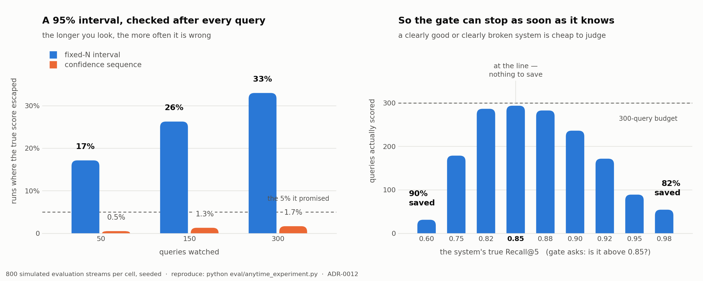
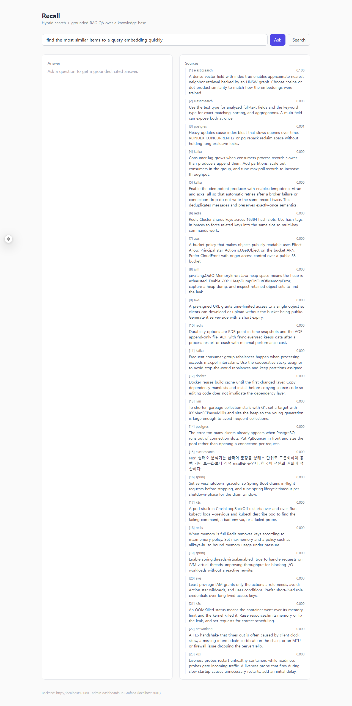
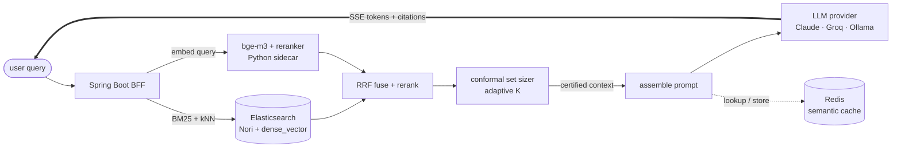
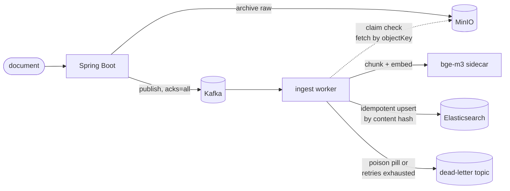
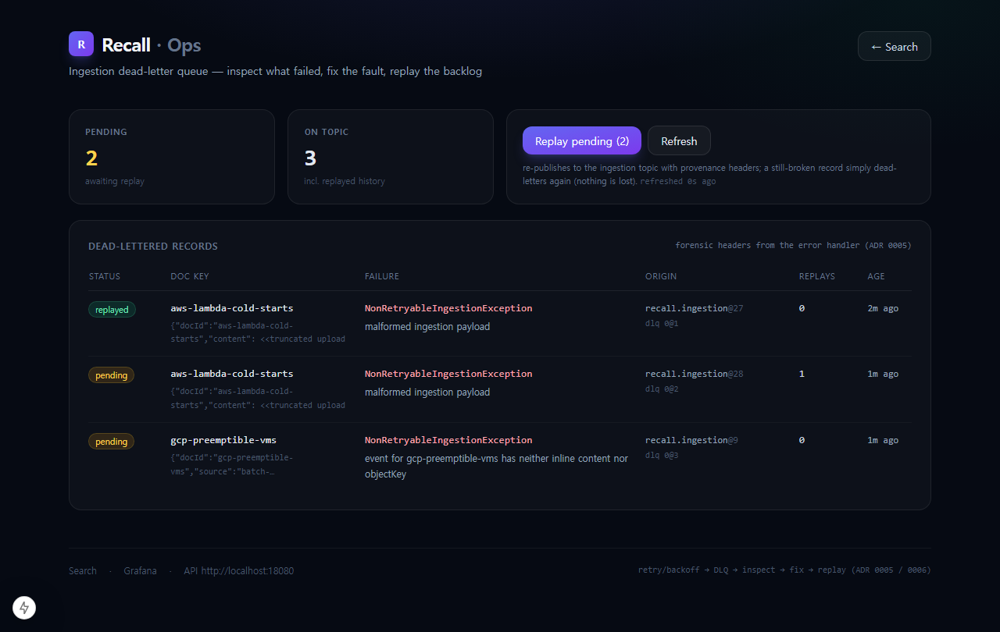

# Recall — 스스로의 주장을 증명할 수 있는 RAG 시스템

[English](README.md) · **한국어** · [日本語](README.ja.md) · [简体中文](README.zh-CN.md)

[](https://github.com/jinwovo/recall/actions/workflows/ci.yml)
[](https://github.com/jinwovo/recall/actions/workflows/eval.yml)

하이브리드(BM25 + 밀집 벡터) 검색과 근거 기반 RAG 질의응답을 백엔드 엔지니어링 문제로 다룬
프로젝트입니다. 그리고 한 번 더 만들었습니다. 첫 번째 버전의 품질 주장이 검증을 통과하지 못했기
때문입니다.

**이 저장소는 대부분 그 검증에 관한 것입니다.** 모든 RAG 시스템은 숫자를 내놓습니다 —
`Recall@5 = 1.00`, `nDCG@10 = 0.96` — 하지만 그 숫자를 *주장*으로 만들어 주는 것을 함께 내놓는
시스템은 거의 없습니다. 검증 도구를 마침내 만들었을 때 가장 먼저 이 저장소의 README에 겨눴고,
헤드라인 주장 세 개가 무너졌습니다.

<picture>
  <source media="(prefers-color-scheme: dark)" srcset="docs/anytime-dark.png">
  
</picture>

---

## 감사(audit)

골드 세트는 쿼리 10개였고 각 쿼리에 관련 문서가 정확히 하나씩이었습니다. 그러니 `Recall@5`는
쿼리마다 동전 던지기이고, 발표된 `1.00`은 10번 중 10번 성공했다는 뜻입니다. 여기서 바로 세 가지가
따라 나오는데, 그중 어느 것도 저장소 어디에도 없었습니다.

| 주장 | 실제로 말하는 것 | 이유 |
|---|---|---|
| `Recall@5 = 1.00` | **`1.00`, 95% CI `[0.69, 1.00]`** | 10/10에서 정확 이항 구간의 하한은 `(α/2)^(1/n) = 0.69`. 31포인트 폭의 숫자가 사실처럼 제시되었습니다. |
| "하이브리드가 BM25 대비 Recall@5를 **+0.30** 올린다" | **p = 0.25 — 그리고 0.25는 이 비교가 낼 수 있는 가장 좋은 p** | 10개 중 7개 쿼리가 동점이고 3개만 다릅니다. 세 쌍에 대한 대응 검정의 p값 하한은 `2/2³`. "유의하지 않다"가 아니라 유의할 *수가 없습니다*. |
| 야간 튜너가 **+0.01 MRR** 개선으로 설정을 배포 | **0.01을 판별하려면 약 7,000개 쿼리가 필요** | 쿼리 10개로 그리드 9점을 탐색해 argmax를 골랐고, 선택에 쓴 바로 그 10개 쿼리로 채점하는 게이트가 검증했습니다. |

```console
$ make eval-stats          # no stack, no network — this is a property of the labels

At least 6 of 10 queries must differ before any outcome can be significant.

    observed      95% interval   width
1.00 (10/10)  [0.692, 1.000]   0.308
 0.70 (7/10)  [0.348, 0.933]   0.586

A tuning loop that acts on a difference smaller than the smallest detectable effect
is not tuning — it is resampling noise.
```

시스템은 설계되었지만 측정은 설계되지 않았습니다. 아래는 두 번째 버전입니다.

---

## 이제 보증이 된 다섯 가지

### 1. 지켜보는 동안에도 유효한 평가

95% 구간이 약속하는 것은 **완료된** 표본을 **한 번** 들여다봤을 때 95% 확률로 참값을 포함한다는
것입니다. 쿼리마다 다시 계산되고 스트리밍되는 동안 계속 지켜보는 구간에 대해서는 아무것도 약속하지
않습니다 — 그런데 모든 CI 실행은 실제로 그렇게 읽힙니다. 셀마다 800개의 시뮬레이션 평가 스트림으로
측정했고, 고정 표본 구간에는 최대한 유리하게 정규근사가 정당화되는 n = 30부터만 들여다보게 했습니다.

| 지표 | 쿼리 | 고정 표본 구간 | 신뢰 수열 |
|---|:---:|:---:|:---:|
| Recall@5 (0/1) | 300 | **34.0%** | 1.9% |
| reciprocal rank (이산, 치우침) | 300 | **32.8%** | 2.6% |
| nDCG@10 (등급) | 300 | **35.1%** | 1.6% |
| groundedness judge (높게 치우침) | 300 | **30.0%** | 0.5% |

*지켜보는 도중 어느 시점에든 참 평균이 명목 95% 구간 밖으로 벗어난 실행의 비율.* 고정 표본 열은
스트림이 길어질수록 커집니다 — 오래 볼수록 틀릴 기회가 많아지기 때문인데, 이는 반복 로그 법칙의
특징이며 시뮬레이션이 제대로 동작한다는 신호입니다.

해법은 **신뢰 수열(confidence sequence)** 입니다. 모든 표본 크기에서 동시에 유효한 구간으로,
[Waudby-Smith & Ramdas (JRSS-B, 2024)]의 헤지된 자본 과정(hedged capital process)으로 만듭니다.
다음 관측마다 가설이 함축하는 배당률로 베팅하면, 귀무가설 하에서 자산은 음이 아닌 마팅게일이 되고,
Ville 부등식이 그것이 `1/α`를 넘을 확률을 제한합니다. 검색 지표는 여기에 유난히 잘 맞습니다 —
reciprocal rank, nDCG, recall, judge 점수 모두 `[0, 1]`에 있고, 분포 모양에 대해 아무것도 가정하지
않습니다.

그래서 조기 중단이 p-해킹이 아니라 정당한 절차가 되고, 게이트는 실제로 그렇게 합니다.

```bash
make eval-gate GATE_POLICY=sequential
```

| 시스템의 실제 Recall@5 | 게이트 판정 | 채점한 쿼리 (300개 중) | 절감 |
|:---:|:---:|:---:|:---:|
| 0.98 | 통과 | 54 | **82%** |
| 0.95 | 통과 | 89 | **70%** |
| 0.85 (정확히 기준선) | `undecided` | 293 | 2% |
| 0.60 | 실패 | 31 | **90%** |

실제 API에 대해 200개 쿼리로: 건강한 시스템은 **69번의 요청**에 통과했고, 고장 난 시스템은 **13번**에
실패했습니다. 절감되는 것은 보고서 속 작은 숫자가 아니라 보내지 않은 HTTP 호출과 쓰지 않은 LLM judge
토큰입니다. `undecided`는 게이트를 실패시킵니다 — "판단할 수 없었다"를 통과로 취급하는 게이트는
조용히 게이트이기를 그만둔 것입니다.

→ [ADR 0012](docs/adr/0012-anytime-valid-evaluation.md) · `make eval-anytime`으로 두 표를 처음부터
재현할 수 있습니다(시드 고정, 스택 불필요).

### 2. 추측이 아니라 보정된 컨텍스트 크기와 답변 거부

두 개의 상수가 이 시스템의 비용과 환각 빈도를 결정했습니다.

```yaml
recall.retrieval.top-k: 8                            # passages that reach the LLM
recall.rag.sufficiency.confidence-threshold: 0.35    # when to answer at all
```

고정 top-K는 양쪽으로 동시에 틀립니다. reranker가 명백히 맞는 passage 하나를 찾은 쿼리에서는 나머지
일곱 개가 노이즈에 쓰는 프롬프트 토큰입니다. 점수가 평평한 애매한 쿼리에서는 같은 K가 답을 담은
passage를 잘라내는데 — 이후 단계 어디서도 이를 알리지 않아, 생성은 답을 뒷받침할 수 없는 컨텍스트에서
진행됩니다.

이제 둘 다 **유한 표본·분포 무관 보증을 갖는 보정된 임계값**입니다. 점수 분포에 대한 가정도,
점근론도, reranker가 잘 보정되어 있어야 한다는 요구도 없습니다.

```
coverage   P(the passages sent to the LLM contain a relevant document)  >= 1 - alpha
risk       P( P(answering from context with no relevant document) <= risk-alpha ) >= 1 - delta
```

앞의 것은 적응형 집합 크기를 쓰는 분할 conformal 예측([Romano, Sesia & Candès, NeurIPS 2020]),
뒤의 것은 고정 순서 검정을 쓰는 위험 통제 예측 집합([Bates et al., JACM 2021])입니다. `make calibrate`는
골드 세트를 한 번 훑어서 둘 다 만듭니다 — `Recall@5`를 채점하는 검색이 이미 관련 문서가 몇 위에
있었는지와 reranker의 확신도를 기록하고 있고, 둘 다 그것만 있으면 됩니다.

한 번의 실행, 쿼리 800개, `alpha = 0.10`, [`eval/_mock_reranker.py`](eval/_mock_reranker.py)의 대역
cross-encoder 기준 — 그래서 스택 없이 재현할 수 있고, `make calibrate`는 실제 reranker로 같은 일을
합니다. 분할: 튜닝 192 / 보정 288 / 홀드아웃 320.

| 홀드아웃 분할에서 | 고정 K *(conformal — 같은 약속)* | 적응형 |
|---|:---:|:---:|
| LLM에 보낸 passage 수 | 9.0 | **5.0** |
| 커버리지 | 91.9% | 90.2% `[86.3, 93.4]` |
| 정답이 1위였을 때 | passage 9개 | **3.2개** |
| 정답이 4위 이하였을 때 | passage 9개 | **8.4개** |

**같은 보증에서 프롬프트 토큰 44% 절감**입니다. 예산이 마침내 필요한 곳으로 옮겨갈 수 있게 되었기
때문입니다. 아무것도 학습하지 못한 reranker도 보증을 깨지 않습니다 — 대가를 컨텍스트 길이로 치를 뿐이며,
이것이 분포 무관 성질이 제 역할을 하는 모습입니다.

같은 실행의 위험 인증서는 **거부되고, 이유를 밝힙니다**. 증명할 수 있는 가장 관대한 임계값이 모든
것에 답변을 거부하는 임계값이라서, 배포되지 않고 degenerate로 표시됩니다. 탐색은 `0.98`에서 멈췄는데,
관측 위험 2.8%로 답할 수 있는 지점이었습니다 — 5% 목표보다 낮지만, 이를 *증명*하려면 보유한 288개가
아니라 약 487개의 보정 쿼리가 필요합니다. 해법은 더 많은 데이터이지 더 느슨한 목표가 아닙니다.

서빙 경로는 Java이고 보정기는 Python인데, 보증은 *하나의* 절차의 성질입니다. 서빙이 보정에서 가정한
것과 다른 K를 계산하면 `alpha`는 아무 의미가 없습니다.
[`ConformalSetSizerTest`](backend/src/test/java/com/portfolio/recall/rag/ConformalSetSizerTest.java)는
24개의 골든 벡터로 둘을 고정하며, 각 벡터는 포함 경계에서 최소 `1e-9` 떨어지게 골라서 두 `exp` 구현의
마지막 ulp 차이가 답을 뒤집을 수 없게 했습니다.

기본값은 **비활성화**입니다. `make calibrate`가 인증서를 만들기 전까지 파이프라인은 고정 top-K를
유지합니다 — `[0, 1]` 밖의 임계값은 보수적인 것이 아니라 설정되지 않은 것입니다.

→ [ADR 0013](docs/adr/0013-conformal-risk-control.md)

### 3. 처음으로 사람과 대조해 본 LLM judge

`groundedness = 0.81`은 CHEAP 등급 모델이 자신이 속한 시스템이 만든 답변에 대해 내린 의견입니다.
그 judge가 8포인트 낙관적이라면 발표된 숫자는 8포인트 틀린 것이고, 파이프라인의 어떤 것도 알아채지
못합니다 — 위의 구간 기계는 틀린 값 주변에 좁은 구간을 충실하게 보고할 것입니다. 모든 RAG 시스템이
이 문제를 갖고 있으며, 규모가 커지면 대형 골드 세트의 *관련성* 라벨도 마찬가지입니다.

**예측 기반 추론(prediction-powered inference)** ([Angelopoulos et al., *Science* 2023][ppi]; PPI++로
검정력 조정)이 출구입니다. 작은 표본에 손으로 라벨을 달고, judge가 전부를 채점하게 한 뒤, 라벨링된
부분에서 측정한 편향을 빼면 됩니다.

```
theta = mean(hand labels) + lambda x ( mean_unlabelled(judge) - mean_labelled(judge) )
```

행마다 라벨링-추정 전체 주기를 1,500번 반복했고, 손 라벨 50개 대 judge 채점 2,050개로, 참값을
정확히 아는 양을 추정했습니다.

| judge 성향 | judge만 | 손 라벨만 | **PPI** | PPI 구간 폭 | 유효 라벨 수 *(50개 중)* |
|---|:---:|:---:|:---:|:---:|:---:|
| 아첨하지만 정확 | **0.0%** | 94.0% | **94.3%** | −67% | **474** |
| 아첨하고 노이즈 많음 | **0.0%** | 94.2% | **93.5%** | −22% | 84 |
| 편향 없지만 노이즈 많음 | 14.5% | 94.7% | **93.7%** | −22% | 85 |
| 정보 없음 | **0.0%** | 94.8% | **94.3%** | −1% | 51 |

*처음 세 열: 각 방법이 발표한 95% 구간이 실제로 참값을 포함한 빈도.* judge 점수 수천 개를 평균하는
것은 95% 구간이 아닙니다 — judge가 믿는 값 주변의 아주 좁은 구간이고, judge가 편향되어 있으면 사실상
절대 맞지 않습니다. "편향 없는" judge조차 실패하는데, `[0, 1]`로 잘린 점수는 경계 근처에서 편향을
얻기 때문입니다.

두 가지 성질이 이 코드를 쓸 가치가 있게 만듭니다. **유효성은 judge가 좋다는 데 결코 의존하지
않습니다** — 편향은 가정되지 않고 측정됩니다. 그리고 **쓸모없는 judge는 비용이 없습니다**: λ는 분산을
최소화하도록 조정되므로, 노이즈를 예측하는 judge는 λ ≈ 0을 받고 추정량은 손 라벨 평균으로 수렴합니다.
맨 아래 행이 그 안전 성질이 작동하는 모습입니다.

```console
$ python run_qa_eval.py gold.jsonl --human-labels judge-labels.jsonl

judge alone      0.886   (no validity — the judge's opinion of its own system)
hand labels only 0.625   [0.156, 1.094]  n=4
PPI              0.637   [0.341, 0.934]  lambda=1.00
judge bias       +0.250  (optimistic)
effective labels 10      (from 4 actually written)
```

**이 저장소는 아직 그 라벨을 작성하지 않았습니다.** 그래서 아래의 `0.81`은 측정값이 아니라 judge의
의견으로 표시되어 있습니다. 기계 장치, 파일 형식, 거부 경로는 모두 들어 있으며, 남은 일은 연구
프로젝트가 아니라 몇 시간의 손 채점입니다.

→ [ADR 0015](docs/adr/0015-prediction-powered-inference.md) · `python eval/ppi_experiment.py`로 표를
재현합니다.

### 4. 하네스가 실제로 판별할 수 있는 벤치마크

위의 모든 도구가 같은 결론에 도달했으므로:

```bash
make beir              # SciFact: 5,183 documents, 300 queries, binary qrels
make beir-eval         # ingest through the real pipeline, then evaluate
```

[BEIR](https://github.com/beir-cellar/beir) (Thakur et al., NeurIPS 2021 D&B)를 이 저장소의 corpus·gold
형식으로, 표준 라이브러리만으로 가져옵니다 — `datasets`도 pyarrow도, 설치할 것이 없습니다. SciFact가
기본값인 이유는 판정이 **이진**이라서, 이 저장소의 이진 이득 `nDCG@10`이 발표된 `nDCG@10`과 같은 의미를
갖기 때문입니다. 등급 데이터셋에서는 판정을 이진화해야 하고 그 결과 nDCG는 비교할 수 *없습니다*.
도구는 독자가 다르게 가정하게 두지 않고 이 경고를 출력합니다.

다운로드와 함께 설계 분석이 나오는데, 듣기 좋은 내용은 아닙니다.

```
smallest attainable p   9.82e-91   (against 2.0e-01 on a 10-query set)
dMRR@10 = 0.02 at sd 0.30 needs 1,766 queries -> short by 1,466
```

판별력이 30배가 되었는데도 2포인트 MRR 변화를 가리기엔 부족합니다. 나중에 발견하는 것보다 출력해 두는
편이 낫습니다.

**SciFact, 측정 결과.** 실제 파이프라인 — Kafka, 청킹, bge-m3, Elasticsearch — 으로 5,183개 문서를
색인하고, 유휴 상태의 머신에서 300개 쿼리를 이진 qrels로 평가했습니다.

| 모드 | Recall@5 | Recall@10 | MRR@10 | nDCG@10 |
|---|:---:|:---:|:---:|:---:|
| bm25 | 0.725 <sub>[0.67, 0.77]</sub> | 0.769 <sub>[0.72, 0.81]</sub> | 0.639 <sub>[0.59, 0.69]</sub> | 0.666 <sub>[0.62, 0.71]</sub> |
| vector | 0.740 <sub>[0.69, 0.79]</sub> | 0.788 <sub>[0.74, 0.83]</sub> | 0.615 <sub>[0.57, 0.66]</sub> | 0.650 <sub>[0.61, 0.69]</sub> |
| **hybrid** | **0.802** <sub>[0.76, 0.84]</sub> | **0.844** <sub>[0.80, 0.88]</sub> | **0.704** <sub>[0.66, 0.75]</sub> | **0.734** <sub>[0.69, 0.77]</sub> |

**BM25 행을 먼저 읽으세요.** BEIR 자체의 SciFact BM25 베이스라인이 보고하는 약 0.665에 대해
`nDCG@10 = 0.666`이 나왔습니다 — 이것이 이 저장소가 가진 것 중 전체 경로가 올바르다는 외부 검증에 가장
가까운 것입니다. 청킹, 분석기, ES 매핑, 청크-문서 중복 제거, 채점 코드가 모두 발표된 설정과 일치해야
그 값이 나오고, 어느 하나라도 잘못되었다면 값이 움직였을 것입니다.

그 베이스라인 대비 `hybrid`는 모든 지표에서 앞서고, 지표별 Holm 보정을 한 대응 무작위화 검정에서
차이가 유의합니다(`nDCG@10` +0.068, Holm p = 0.0002). **`vector` 단독은 그렇지 않습니다** — recall에서는
노이즈 범위 안이고, 순위에 민감한 지표에서는 BM25보다 약간 *뒤처집니다*(`MRR@10` −0.025, Holm p = 0.25).
여기서 밀집 검색은 혼자서는 BM25를 이기지 못합니다. 이득은 실제로 융합과 재순위화에서 나오며, 이것이
아키텍처가 기대고 있는 주장이고 이제 가정이 아니라 측정된 사실입니다.

골드 세트는 이 비교에 충분한 검정력을 가지며 스스로 그렇다고 말합니다. 300개 쿼리는 80% 검정력에서
`MRR@10` 효과 +0.051을 판별하고, 측정된 효과는 +0.065입니다. 2포인트 변화에 대해서는 검정력이 *없으며*
— 1,918개 쿼리가 필요합니다 — `power_report.py`가 둘 다 출력합니다.

전체 표, 쿼리별 첫 적중 순위, 부트스트랩 구간: [`docs/beir-summary.md`](docs/beir-summary.md)와
[`docs/beir-results.json`](docs/beir-results.json), `make beir-eval`로 재생성됩니다. 그 비용 — 그리고
첫 실행이 그에 대해 잘못 알았던 수정 사항과 함정 — 은 [벤치마크 런북](docs/BENCHMARK-RUNBOOK.md)에
있습니다. 첫째로, 이 실행은 재순위화 지연 시간이 시사하는 몇 분이 아니라 노트북 CPU에서 약 14시간
걸리는 작업입니다.

→ [ADR 0014](docs/adr/0014-beir-benchmark-scale.md)

### 5. 2번의 인증서는 만료되며, 이제 시스템이 그렇다고 말합니다

두 절 위의 그 임계값은 유효숫자 18자리가 그 근처 어디에도 적혀 있지 않은 가정 위에 서 있는 것입니다.
보정에 쓴 쿼리와 서빙하는 쿼리가 같은 분포에서 와야 한다는 가정입니다. 살아 있는 코퍼스는 일주일이면
이를 깨뜨립니다 — 문서가 색인되고, 질의 구성이 바뀌고, 누군가 임베딩 모델을 교체합니다 — 그리고 그
실패는 조용합니다. 설정은 그대로이고, 대시보드는 녹색이고, 약속은 더 이상 참이 아닙니다.

수준(level)은 실현된 미커버리지로 구동되는 제어 변수가 됩니다(Gibbs & Candès, NeurIPS 2021). 업데이트를
합하면 정확한 항등식으로 망원(telescope)되고, `alpha_t`는 `[-gamma, 1+gamma]`를 벗어날 수 없으므로,
장기 커버리지는 **어떤 분포 가정도 없이** 목표로 수렴합니다 — 교환가능성도, 정상성도, 심지어 변화가
적대적이 아니라 무작위라는 가정도 필요 없습니다.

스트림 200개, 각 3,000개 쿼리, 약속 90%:

| 시나리오 | 고정 임계값 | 롤링 윈도우 | 적응형 |
|---|---|---|---|
| 위치 이동 (+0.30) | 0.459 | 0.876 | **0.900** |
| 점수 포화 | 0.306 | 0.939 | **0.903** |

**흥미로운 것은 가운데 열이며, 제가 찾으려던 결과가 아닙니다.** 단순한 위치 이동에 대해서는 롤링
윈도우가 사실상 모든 일을 혼자 합니다 — 분위수가 데이터와 함께 움직이고 제어기는 이동을 보지도
못합니다. 테스트는 이를 항등식으로 고정합니다: 0.00, 0.20, 0.30 이동에서 수준이 목표에서 가장 멀리
벗어난 폭은 *같은* 0.100입니다. 이 절의 이전 초안은 제어기가 거기서 드리프트를 잡아낸다고 주장했습니다.
그렇지 않았고, 증거처럼 보였던 숫자는 테스트 생성기가 점수를 1.0에서 잘라낸 데서 생긴 인공물이었습니다.

제어기가 실제로 하는 일은 잔차와, 윈도우가 따라갈 수 없는 경우입니다. 윈도우는 잘 작동할 때도
체계적으로 어긋납니다 — 87.6%로 과소 커버하고, 포화 상황에서는 93.9%로 *과대* 커버하는데, 이는 안전이
아니라 보증이 필요로 하는 것보다 큰 집합에 쓰는 프롬프트 토큰입니다. 그리고 대부분의 후보가 동점 최고
점수 하나에 몰리면 어떤 롤링 분위수도 그들을 구분하지 못합니다. 옮겨진 수준만이 커버리지를 지탱하며,
그래서 신호의 이름이 `drifting`이 아니라 `compensating`입니다. 윈도우가 흡수하는 이동에서는 False를
유지하고(0/60), 포화되는 모든 스트림에서 발화합니다(60/60).

**그리고 서빙 경로가 그것을 소리 내어 말합니다.** `CoverageMonitor`(Java)는 groundedness judge를 커버리지
신호로 써서 배포된 인증서를 감시하고, 약속된 비율이 *배제*되면 경고합니다 — 35%를 놓치는 스트림에서
43번째 쿼리에. 이것은 anytime-valid여야 하며, 여기서 1번이 제 값을 합니다. 이 스트림은 쿼리마다
검사되는데, 바로 그 방식에서 고정 표본 구간이 30–35%의 확률로 빗나가는 것이 측정되었습니다. 여기서
이항 검정을 쓰면 매주 헛경보를 울릴 것입니다.

경보는 단측입니다. 약속보다 *더 잘* 커버하는 시스템은 보수적인 방법의 평범한 상태이지 사고가 아니기
때문입니다 — 과대 커버리지는 토큰 비용 게이지이지 호출 대상이 아닙니다. 코드가 숨기지 않고 밝히는 두
가지 단서가 있습니다. judge는 편향된 도구이므로(3번) 이것은 참값이 아니라 judge의 미커버리지이고,
judge는 답변 거부와 캐시 적중을 건너뛰므로 트래픽의 부분 모집단을 감시합니다. 온도계가 아니라
화재 감지기입니다. 제어기 자체는 오프라인에 머뭅니다 — 쿼리마다 비순응 점수가 필요한데, 서빙에는 그것을
계산할 골드 라벨이 없습니다. 그래도 배포한다면 보증 없는 보증 모양의 물건이 될 것입니다.

→ [ADR 0016](docs/adr/0016-adaptive-conformal-drift.md) · `python eval/adaptive_experiment.py`로 표를
재현합니다.

### 다음: 답변 자체의 문장에 대한 보증

위의 모든 것은 답변 *이전*의 단계 — 컨텍스트, 답할지의 결정, judge — 를 인증합니다. 그중 어느 것도
답변의 어느 문장이 참인지 말하지 않습니다. groundedness judge는 답변 전체를 채점하므로, 지어낸 주장
하나는 좋은 주장 다섯 개와 함께 배포되거나 그것들을 함께 끌어내립니다.

[ADR 0017](docs/adr/0017-claim-level-conformal-factuality.md)은 인증서를 claim 단위로 옮깁니다(Mohri &
Hashimoto, ICML 2024; Conformal-RAG, SIGIR 2025). 각 claim을 검색된 passage에 대해 채점하고, conformal
보정된 임계값 아래의 것을 버리면,

```
P( every claim left in the answer is supported ) >= 1 - alpha
```

시뮬레이션(`make eval-factuality`, α = 0.10)에서 필터링하지 않은 답변이 완전히 뒷받침되는 경우는
**38%** 이고, 필터링하면 **90.0%** 이며 참인 claim의 88%를 유지합니다. 도메인별로 보정하면 어려운 그룹이
82%에서 약속된 90%로 올라갑니다. 그리고 이 기법에 대한 2026년 감사([arXiv 2603.16817](https://arxiv.org/abs/2603.16817))가
발견한 한계도 숨기지 않고 재현합니다. 거짓 claim을 함축된 것처럼 보이게 만드는 교란 passage는 이를
**52%** 로 떨어뜨립니다. 이것은 시뮬레이션된 채점기에서의 절차의 성질입니다.

서빙에서도 실행됩니다(`recall.rag.factuality.enabled`). 완성된 답변의 각 문장을 LLM이 본 passage에 대해
cross-encoder로 judge와 병렬로 채점하고, 임계값 이하의 claim은 삭제하지 않고 **그 자리에서 취소선으로
표시**합니다 — 독자는 어느 문장에 근거가 없었는지 볼 수 있습니다. 보류된 claim이 있는 답변은 절대
캐시되지 않습니다. 보정 전(`threshold: -1`)에는 observe 모드입니다. claim을 채점해 보고하지만 아무것도
보류하지 않으며, 그 점수와 claim마다 사람이 단 라벨을 `python eval/factuality.py labels.jsonl`이 붙여넣을
임계값으로 바꿉니다. 그 라벨 세트는 아직 없으므로 배포된 임계값도 없습니다. 생기면 인증서는 커버리지와
같은 anytime-valid 만료 경보(5번)를 받으며, judge의 판정은 전체 답변이 아니라 독자에게 남겨진 텍스트에
대한 것입니다 — 전체 답변을 판정하면 필터가 제거한 claim 때문에 필터를 탓하게 되기 때문입니다.

### 그리고 이제 튜너도 스스로를 증명해야 합니다

야간 탐색은 층화된 개발 분할을 탐색하고, 제안은 네 개의 가드를 통과해야 합니다 — 효과 크기 하한,
그리드 전체에 대한 Holm 보정 대응 무작위화 검정, 그리고 **탐색이 한 번도 건드리지 않은 홀드아웃
분할**에서도 개선이 보여야 한다는 것. 개발-홀드아웃 차이는 탐색이 만든 과적합으로 출력됩니다. 데이터가
부족해서 가드가 실패하면, 보고서는 더 작은 epsilon을 제안하는 대신 이를 판가름할 쿼리 수를 알려 줍니다.

배포된 10개 쿼리 골드 세트에서는 사실상 절대 발화하지 않는다는 뜻입니다. 그것이 올바른 동작입니다.
→ [ADR 0011](docs/adr/0011-statistical-inference-eval.md)

---

## 내 저장소에서 eval 게이트 사용하기

위의 모든 것은 이 시스템에 특화된 것이 아니므로 단독으로도 쓸 수 있습니다.

```bash
pip install retrieval-eval-gate       # `rag-eval-gate` on PyPI is an unrelated project
rag-eval-gate power gold.jsonl        # what your gold set can resolve, before anything runs
rag-eval-gate audit -n 10 -v 1.00 -b 0.70    # or audit a published table, with no data at all
```

아무것도 설치할 필요 없는 브라우저 버전도 있습니다:
**[jinwovo.github.io/rag-eval-gate](https://jinwovo.github.io/rag-eval-gate/)**.

→ **[jinwovo/rag-eval-gate](https://github.com/jinwovo/rag-eval-gate)** — 의존성 0개이며, 이 저장소의
하네스와 달리 백엔드에 구애받지 않습니다. 필드 매핑을 갖는 HTTP URL 템플릿, stdout으로 JSON을 출력하는
명령(그래서 검색기의 언어는 무관합니다), 또는 TREC run 파일(그래서 코퍼스를 오프라인으로 한 번 순위를
매기고 아무것도 실행하지 않은 채 평가할 수 있습니다)을 받습니다. 골드 세트는 JSONL 또는 TREC qrels입니다.

```yaml
- uses: jinwovo/rag-eval-gate@v0
  with:
    gold-file: eval/gold.jsonl
    url-template: 'http://localhost:8080/api/search?q={query}&mode={mode}'
    gate-policy: sequential            # point | ci-lower | regression | sequential
    min-mrr10: "0.85"
```

이 저장소는 트리 내 게이트용으로 자체 벤더링 사본을 유지합니다. 이 사본은 Kafka 파이프라인으로 코퍼스를
시딩하고 비동기 색인이 수렴할 때까지 기다리기도 합니다 — 범용 도구가 알 필요가 없는 일입니다.

```yaml
- uses: jinwovo/recall/.github/actions/rag-eval-gate@main
  with:
    api-url: http://localhost:8080
    gold-file: eval/gold.jsonl
    corpus-file: eval/corpus.jsonl     # seed + wait for async indexing first
    gate-policy: sequential
```

어느 쪽이든 모든 지표에 95% 구간, Holm 보정으로 베이스라인 대비 유의성 검정한 각 모드, 골드 세트가
애초에 무엇을 판별할 수 있는지에 대한 진술, 그리고 단계 요약의 `✅ PASS` / `❌ FAIL`을 얻습니다. 우리
자신의 eval 워크플로가 트리 내 액션을 사용합니다 — 도그푸딩이 호환성 테스트입니다.

| `gate-policy` | 실패 조건 | 사용할 때 |
|---|---|---|
| `point` *(기본값)* | 평균이 임계값 아래로 떨어짐 | 항상 — 절대 하한 |
| `ci-lower` | 95% 하한이 임계값 아래로 떨어짐 | 골드 세트가 커서 구간이 안전 여유보다 좁을 때 |
| `regression` | *추가로* 기록된 실행 대비 유의한 대응 하락 | 비교할 녹색 베이스라인이 있을 때 |
| `sequential` | anytime-valid 판정이 `fail`이거나, 예산이 `undecided`로 소진됨 | 쿼리가 돈이나 시간을 쓸 때 |

`regression`이 민감한 정책입니다. 절대 임계값은 평균이 누군가 추측한 선을 넘어야 회귀를 알아채지만,
대응 검정은 *같은 쿼리*를 전후로 비교하므로 평균이 아직 선을 넘는 동안에도 두 쿼리의 실제 하락을
잡아냅니다.

## eval 하네스는 프로덕션 코드처럼 테스트됩니다

실제로 프로덕션 코드이기 때문입니다. nDCG를 잘못 계산하면 이후의 모든 숫자가 틀리고, 빌드의 다른 어떤
것도 그렇다고 말하지 않습니다.

```bash
make eval-test     # 267 tests, standard library only, no stack, ~90s
```

- **닫힌 형식** — `k = n`에서 `(α/2)^(1/n)`, 균일 개선에 대한 `2^(1-k)`, R의 `p.adjust` 예제,
  `(n+1)` conformal 분위수 보정.
- **독립 구현** — 테스트 안에 별도로 작성한 브루트포스 순열 참조 구현, SciPy가 없으면 건너뛰는 SciPy
  교차 검증.
- **시뮬레이션으로 확인하는 보증** — 보정-배포 주기를 반복하며 각 약속이 실제로 얼마나 자주 깨지는지
  셉니다. 치우친 모집단에 대한 BCa 커버리지, 연속 검사 하의 신뢰 수열 커버리지, 적합에 쓰지 않은
  데이터에서의 conformal 커버리지, 위험 인증서의 1종 오류, 의도적으로 편향된 judge에 대한 PPI 커버리지
  — 음성 대조군과 함께. 추정량은 그것이 대체하는 것이 확실히 실패할 때만 흥미롭기 때문입니다.
- **하네스 종단 간** — 손으로 지표를 유도할 수 있는 스텁 검색 백엔드에 대해, 네 가지 게이트 정책을
  두 결과 모두로 몰고 가며, 순차 정책의 절감이 실제로 보내지 않은 요청임을 확인합니다.

여기에 백엔드 단위 테스트 117개와, 실제 ES, Kafka, MinIO에 대한 Testcontainers 통합 테스트 스위트 세 개가
더해집니다.

---

## 데모

근거 기반 RAG QA, 실시간(4배속) — **영어 코퍼스에 대한 한국어 질문**(bge-m3를 통한 교차 언어 검색).
파이프라인 단계 표시가 **retrieve → generate → verify**를 따라가는 동안 답변이 인라인 `[n]` 인용과 함께
토큰 단위로 스트리밍됩니다. **grounded** 배지는 사후 LLM judge의 판정(ADR 0004)이며, 인용을 클릭하면
인용된 출처가 강조됩니다. 생성은 무료 로컬 LLM(Ollama, CPU)입니다.


하이브리드 검색 화면 — 검색 모드 전환(hybrid / bm25 / vector), 출처별 점수 막대, 클라이언트에서 측정한
지연 시간:



## 빠른 시작

**약 5분이면 직접 실행할 수 있습니다.** API 키가 필요 없습니다(Ollama를 통한 무료 로컬 LLM).

```bash
cp .env.example .env                 # optional: ANTHROPIC_API_KEY, or use free Ollama
docker compose up -d                 # ES (Nori), Redis, Postgres, Kafka, MinIO, sidecar, Grafana
cd backend && ./gradlew bootRun      # wrapper is committed; a JDK 21 is all you need
cd frontend && npm install && npm run dev      # http://localhost:3000

python scripts/seed_corpus.py                  # ingest the eval corpus (waits for indexing)
make eval-gate                                 # bm25 vs vector vs hybrid, with intervals
```

내 코퍼스를 위한 셀프 호스팅 하이브리드 검색 / RAG 스타터로 쓰기:

```bash
python scripts/ingest_folder.py ~/my-docs      # .md / .txt / .html (+ .pdf with pypdf)
```

모든 파일은 실제 파이프라인 — Kafka, 청킹, 임베딩, 멱등 upsert, ADR 0005의 내구성 계약 — 을 거치며,
명령은 모든 것이 실제로 검색 가능해질 때까지 기다립니다. 다시 실행하는 것이 동기화 방식입니다.

[`mcp-server/`](mcp-server/)는 `recall_search`와 `recall_ask`를 Model Context Protocol로 노출하므로,
내 문서가 Claude Desktop / Claude Code의 에이전트 도구가 됩니다. 인용과 groundedness 판정도 포함됩니다.

## 아키텍처

질의 / RAG 경로:



색인 경로 — 비동기, 멱등, 유실 방지(재시도/백오프 → DLQ, 큰 문서는 claim-check 패턴으로 MinIO 참조로
전달):



컴포넌트 상세는 [`docs/ARCHITECTURE.md`](docs/ARCHITECTURE.md)에 있습니다.

## 검색 품질

실행 중인 스택에서 24개 문서 코퍼스와 10개 쿼리 골드 세트(정확한 용어, 바꿔 말하기, 한국어 교차 언어)로
BBQ 양자화 색인에 대해 측정했습니다. 문서 수준 지표이며, 청크 적중은 첫 등장 기준으로 중복 제거했습니다.

| 모드 | Recall@5 | 95% CI | MRR@10 | nDCG@10 |
|---|:---:|:---:|:---:|:---:|
| BM25 단독 | 0.70 | `[0.35, 0.93]` | 0.67 | 0.70 |
| 벡터 단독 | 1.00 | `[0.69, 1.00]` | 0.90 | 0.93 |
| **hybrid (RRF + cross-encoder)** | **1.00** | `[0.69, 1.00]` | **0.95** | **0.96** |
| hybrid, `rerank=m3` (3모드 셀프 하이브리드) | 1.00 | `[0.69, 1.00]` | 0.90 | 0.93 |
| `mode=hyde` (가상 문서 kNN, 재순위화 없음) | 0.90 | `[0.56, 1.00]` | 0.80 | 0.85 |

**이 표는 위의 감사가 말하는 방식대로 읽으세요.** Recall 구간은 보고된 값에서 정확히 따라 나옵니다 —
쿼리마다 관련 문서가 하나이므로 각 값은 10번 중 성공 횟수입니다 — 그리고 구간이 넓은 것은 시스템이
불안정해서가 아니라 쿼리 10개가 작은 표본이기 때문입니다. MRR과 nDCG 열은 점 추정치이며, `run_eval.py --json`을
다시 실행하면 부트스트랩 구간이 나옵니다. BM25에서 hybrid로의 순서는 일관적이고 놀랍지 않습니다 —
정확한 용어 쿼리는 BM25에 유리하고, 바꿔 말한 쿼리와 한국어 쿼리는 밀집 벡터에 유리하며, 한국어 쿼리
두 개는 모두 BM25가 놓친 것을 hybrid가 1위로 올립니다 — 하지만 차이의 *크기*는 이 표본 크기로는 판별할
수 없고, 그것이 `make beir`가 있는 이유입니다.

여기서 양자화는 품질에 중립적입니다. float32 색인에서 같은 탐색을 하면 모든 밀집 모드에서 ±0.02 이내였습니다.

### 논문 기반 기법

모든 검색 단계는 출처를 밝히며, 모두 같은 방식으로 도입되었습니다. 구현하고, eval 하네스로 탐색하고,
숫자를 공개했습니다.

| 기법 | 논문 | 이 저장소에서 |
|---|---|---|
| Reciprocal Rank Fusion | Cormack et al., SIGIR 2009 | BM25 + kNN 융합 (`rrf-k=60`) |
| 다국어 밀집 검색 + cross-encoder 재순위화 | BGE / bge-reranker-v2-m3, Chen et al. 2024 | 임베딩 사이드카, 기본 재순위화 |
| M3 3모드 셀프 하이브리드 (dense + sparse + ColBERT) | *BGE M3-Embedding*, Chen et al. 2024 | `?rerank=m3` — 임베더 자체의 헤드, 추가 모델 없음 |
| HyDE (가상 문서 임베딩) | Gao et al., ACL 2023 | `?mode=hyde`, 실패 시 벡터 검색으로 fail-open |
| 충분한 컨텍스트 게이트 | Joren et al., **ICLR 2025** | 생성 전 자동 평가기, PRIMARY 호출 전에 답변 거부 |
| RaBitQ 1비트 양자화 (ES **BBQ**) | Gao & Long, **SIGMOD 2024** | `bbq_hnsw` + 오버샘플 재채점, 벡터 메모리 약 32배 절감 |
| **IR을 위한 대응 무작위화 검정** | Smucker, Allan & Carterette, CIKM 2007 | 모드 비교, Holm 보정 |
| **베팅 신뢰 수열** | Waudby-Smith & Ramdas, **JRSS-B 2024** | 순차 게이트 |
| **Conformal 예측, 적응형 집합** | Romano, Sesia & Candès, NeurIPS 2020 | 적응형 컨텍스트 크기 |
| **위험 통제 예측 집합** | Bates, Angelopoulos, Lei, Malik & Jordan, **JACM 2021** | 보정된 답변 거부 |
| **예측 기반 추론** | Angelopoulos, Bates, Fannjiang, Jordan & Zrnic, **Science 2023** | 편향된 judge로부터 참 groundedness의 유효한 구간 |
| **BEIR** | Thakur et al., NeurIPS 2021 D&B | `make beir` |

GraphRAG / RAPTOR와 late chunking은 평가 후 의도적으로 보류했습니다 — 기각 근거는
[ADR 0008](docs/adr/0008-paper-backed-retrieval-m3-hyde.md)에 있습니다.

### RAG 답변 품질 (groundedness)

[`eval/run_qa_eval.py`](eval/run_qa_eval.py)로 측정했으며, 무료 로컬 프로바이더(Ollama, CPU의
`qwen2.5-coder:3b`)가 생성과 판정을 모두 했습니다.

| 지표 | 값 |
|---|---|
| groundedness (평균 judge 점수) | **0.81** ⚠️ *judge의 의견 — 아직 사람 기준점 없음, [ADR 0015](docs/adr/0015-prediction-powered-inference.md) 참조* |
| 판정 (8개 판정) | 75% supported · 12% partial · 12% unsupported |
| 답변 거부 ("I don't know") | 2/10 — 환각 대신 거부 |
| 인용 포함률 | 생성된 답변의 **100%** 가 `[n]` 인용 포함 |
| TTFT p50 / e2e p50 | 30.5s / 54s *(로컬 CPU 3B — prefill 병목, API 프로바이더를 대표하지 않음)* |

`UNSUPPORTED` 답변 하나는 judge가 표시해 시맨틱 캐시에서 제외되었습니다(ADR 0004) — 녹색 체크 표시가
아니라 가드레일이 신호를 만드는 모습입니다. 판정된 답변 8개는 이 페이지의 다른 모든 것과 같은 작은 표본
문제이며, 그래서 QA 평가는 아직 CI 게이트가 아닙니다.

## 환각 가드레일 — 생성 전과 후

두 가드 모두 fail-open이며, LLM 호출의 양쪽에 있습니다.

**생성 전 (ADR 0009 / ICLR 2025, 임계값은 이제 ADR 0013이 인증):** reranker의 최고 점수가 보정된 임계값보다
낮으면, CHEAP 등급 자동 평가기가 한 단어로 답합니다 — 이 passage들로 이 질문에 답할 수 있는가?
`INSUFFICIENT` → 파이프라인은 PRIMARY 생성을 쓰기 *전에* 답변을 거부합니다. 확신 있는 검색은 이 확인을
완전히 건너뛰므로 p50 TTFT는 영향을 받지 않습니다.

**생성 후 (ADR 0004):** 생성된 모든 답변은 스트리밍이 끝난 뒤(그래서 TTFT에 영향 없음) 같은 passage와
완성된 답변을 보는 CHEAP 등급 judge가 채점하며, `SUPPORTED` / `PARTIAL` / `UNSUPPORTED`를 반환합니다.
판정은 UI에 배지로 스트리밍되고, `query_log` 행에 기록되며, Prometheus로 전달됩니다. 답변 거부는 절대
환각으로 채점되지 않으며, `UNSUPPORTED`로 판정된 답변은 절대 캐시되지 않습니다.

## 색인 신뢰성

`POST /api/ingest`가 202를 반환하는 것은 낙관적 응답이 아니라 내구성 계약입니다. 응답 *전에* 원본 문서가
MinIO에 보관되고 Kafka 발행이 브로커 확인(`acks=all`)을 받습니다. 64 KB를 넘는 문서는 `objectKey` 참조로
Kafka를 통과합니다 — claim-check 패턴 — 그래서 문서 크기가 브로커 메시지 한도와 싸울 일이 없습니다.
컨슈머에서는 일시적 실패가 지수 백오프로 제자리에서 재시도되고, 형식이 잘못된 이벤트는 재시도를
건너뜁니다. 둘 다 재처리할 준비가 된 포렌식 헤더와 함께 `recall.ingestion.dlq`로 갑니다. 모든 분기는
실제 Kafka + MinIO에 대한 `IngestionReliabilityIT`로 증명됩니다.

DLQ는 무덤이 아니라 큐입니다. **`/admin` 운영 페이지**가 장애 대응 고리를 닫습니다 — 디코딩된 포렌식을
확인하고, 결함을 고치고, 원클릭 **replay**. Replay는 DLQ 오프셋을 커밋하기 *전에* 브로커 확인을 받아
재발행하고(의도적인 at-least-once — 청크 upsert는 콘텐츠 해시로 멱등), 오래된 `kafka_dlt-*` 헤더를
제거해 재실패 시 새 포렌식을 얻게 하며, 반복 왕복에도 살아남는 출처 정보를 남깁니다. `DlqReplayIT`로
종단 간 증명됩니다. → [ADR 0005](docs/adr/0005-ingestion-reliability-dlq-claim-check.md),
[ADR 0006](docs/adr/0006-dlq-replay-admin.md)



## 기술 스택

- **백엔드:** Java 21, Spring Boot, WebFlux (SSE)
- **LLM:** `recall.llm.provider`로 교체 가능 — Claude(기본), 또는 OpenAI 호환 Groq / Ollama(로컬, 무료, 키 불필요)
- **검색 / 벡터:** Elasticsearch 8.18 (Nori 분석기 + `dense_vector` kNN, 오버샘플 재채점을 쓰는 BBQ 양자화)
- **임베딩 / 재순위화:** `BAAI/bge-m3` + `BAAI/bge-reranker-v2-m3` (Python FastAPI 사이드카)
- **메시징:** Kafka (비동기 색인) · **저장소:** Redis, PostgreSQL, MinIO/S3
- **프런트엔드:** Next.js, TypeScript, Tailwind · **관측성:** Micrometer + Prometheus + Grafana
- **평가:** 표준 라이브러리 Python — composite action이 설치해야 할 의존성 없음

## API

| 메서드 | 경로 | 비고 |
|---|---|---|
| `GET` | `/api/search?q=&mode=&rerank=` | `mode` = `hybrid`(기본) `\|` `bm25` `\|` `vector` `\|` `hyde`; `rerank` = `cross-encoder`(기본) `\|` `m3` |
| `GET` | `/api/ask?q=` | SSE 스트림: `sources`, `sufficiency`, `token`, `finish`, `judging`, `groundedness`, `claims`, `done` |
| `POST` | `/api/ingest` | 비동기 색인; `202` ⇒ 원본 보관 + 브로커 확인 완료 |
| `GET` | `/api/admin/dlq?limit=` | DLQ 깊이 + 디코딩된 포렌식 헤더를 포함한 제한된 미리보기 |
| `POST` | `/api/admin/dlq/replay?max=` | 대기 중인 DLQ 레코드를 색인 토픽으로 되돌림 |
| `GET` | `/actuator/prometheus` | 메트릭 수집 |

## 프로젝트 구조

```
backend/            Spring Boot (Java 21) — search, rag, ingestion, llm providers, cache
embedding-service/  Python FastAPI sidecar — bge-m3 embeddings + bge-reranker
frontend/           Next.js UI — search / QA, streamed answers, citation highlight
mcp-server/         MCP stdio server — your corpus as agent tools
eval/               the harness: stats, sequential, conformal, calibrate, beir, power_report
deploy/helm/recall/ Helm chart (k8s)
monitoring/         Prometheus + Grafana provisioning
docs/adr/           every decision, including the ones that overturned earlier ones
```

## 결정 기록 (ADR)

- [ADR 0001 — 하이브리드 검색 (BM25 + 벡터 + RRF + 재순위화)](docs/adr/0001-hybrid-retrieval-bm25-vector-rrf.md)
- [ADR 0002 — LLM 비용·지연 최적화](docs/adr/0002-llm-cost-optimization-strategy.md)
- [ADR 0003 — Kafka를 통한 비동기·멱등 색인](docs/adr/0003-async-ingestion-kafka.md)
- [ADR 0004 — 사후 groundedness judge](docs/adr/0004-groundedness-guardrail.md)
- [ADR 0005 — 색인 신뢰성: 재시도, DLQ, claim-check 저장](docs/adr/0005-ingestion-reliability-dlq-claim-check.md)
- [ADR 0006 — 관리 화면에서의 DLQ replay](docs/adr/0006-dlq-replay-admin.md)
- [ADR 0007 — CI 회귀 게이트로서의 검색 평가](docs/adr/0007-eval-ci-regression-gate.md)
- [ADR 0008 — 논문 기반 검색: M3 셀프 하이브리드 & HyDE](docs/adr/0008-paper-backed-retrieval-m3-hyde.md)
- [ADR 0009 — 충분성 게이트 & BBQ 양자화 벡터](docs/adr/0009-sufficient-context-bbq.md)
- [ADR 0010 — 포트폴리오에서 도구로: 폴더 색인, MCP, 재사용 가능한 게이트, 자가 튜닝](docs/adr/0010-tool-round-ingest-mcp-action-selftune.md)
- **[ADR 0011 — 검색 점수는 추정치이며, 추정치로 보고된다](docs/adr/0011-statistical-inference-eval.md)**
- **[ADR 0012 — Anytime-valid 평가: 판정이 나면 멈춘다](docs/adr/0012-anytime-valid-evaluation.md)**
- **[ADR 0013 — 비용과 환각을 결정하는 상수가 인증서가 된다](docs/adr/0013-conformal-risk-control.md)**
- **[ADR 0014 — 하네스가 실제로 판별할 수 있는 벤치마크](docs/adr/0014-beir-benchmark-scale.md)**
- **[ADR 0015 — LLM judge는 측정 도구이며, 한 번도 보정된 적이 없었다](docs/adr/0015-prediction-powered-inference.md)**
- **[ADR 0016 — 인증서는 만료되며, 아무도 알려주지 않는다](docs/adr/0016-adaptive-conformal-drift.md)**
- **[ADR 0017 — 보증이 답변에 닿는다: claim 단위 conformal 사실성](docs/adr/0017-claim-level-conformal-factuality.md)**

(ADR 본문은 영어입니다.)

## 로드맵

- 인증된 claim 임계값(ADR 0017): `make collect-claims`가 라벨링할 observe 모드 claim을 모으고
  `make certify-claims`가 이를 임계값으로 바꿉니다 — 빠진 것은 [라벨링 가이드](docs/LABELING-GUIDE.ko.md)에
  따라 수백 개를 라벨링할 사람입니다
- 예산이 있는 API 키로 CI에서 LLM 판정이 가능해지면, groundedness 평가를 두 번째 CI 게이트로
- `claude` 프로바이더 설정 시 Claude 네이티브 인용(정확한 문자 범위 근거)
- 답변 거부 임계값을 검색 대리 지표가 아니라 judge 판정에 대해 보정하기

## 라이선스

MIT — [`LICENSE`](LICENSE) 참조.

[Waudby-Smith & Ramdas (JRSS-B, 2024)]: https://doi.org/10.1093/jrsssb/qkad009
[Romano, Sesia & Candès, NeurIPS 2020]: https://arxiv.org/abs/2006.02544
[Bates et al., JACM 2021]: https://arxiv.org/abs/2101.02703
[ppi]: https://www.science.org/doi/10.1126/science.adi6000
