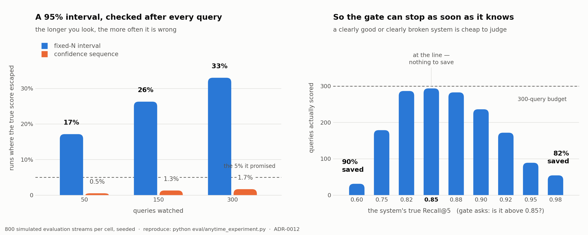
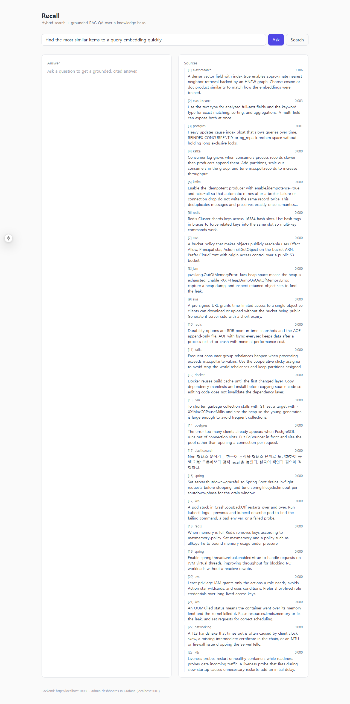
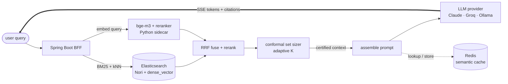
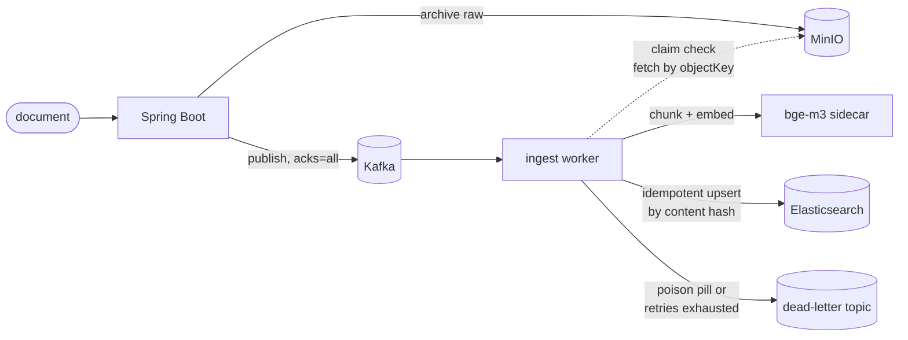
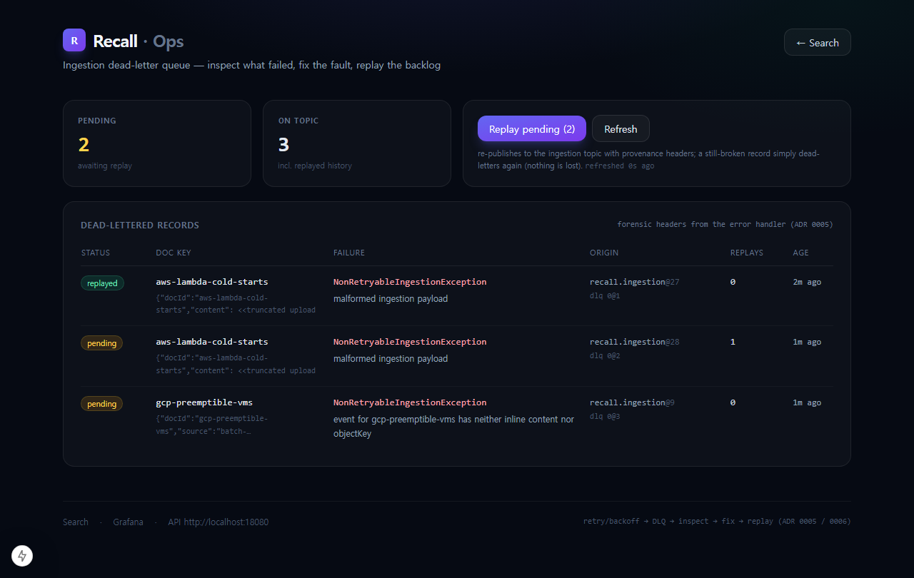

# Recall — 能够证明自身主张的 RAG 系统

[English](README.md) · [한국어](README.ko.md) · [日本語](README.ja.md) · **简体中文**

[](https://github.com/jinwovo/recall/actions/workflows/ci.yml)
[](https://github.com/jinwovo/recall/actions/workflows/eval.yml)

混合(BM25 + 稠密向量)检索与有据可依的 RAG 问答,作为一个后端工程问题来构建。然后又重建了一次,
因为第一个版本的质量声明没能经受住检验。

**这个仓库的主体是检验本身。** 每个 RAG 系统都会给出数字 —— `Recall@5 = 1.00`、`nDCG@10 = 0.96` ——
但几乎没有一个会同时给出让数字成为*主张*的那样东西。当检验工具终于写好时,它们首先被用在了这个仓库
自己的 README 上,结果三条标题级主张没能通过。

<picture>
  <source media="(prefers-color-scheme: dark)" srcset="docs/anytime-dark.png">
  
</picture>

---

## 审计

金标准集有 10 个查询,每个查询恰好对应一篇相关文档,所以 `Recall@5` 对每个查询来说就是一次抛硬币,
公布的 `1.00` 意味着十次中成功十次。由此立即可以推出三件事,而仓库里没有任何地方提到它们:

| 主张 | 它实际能说明什么 | 原因 |
|---|---|---|
| `Recall@5 = 1.00` | **`1.00`,95% CI `[0.69, 1.00]`** | 10/10 时的精确二项区间下限为 `(α/2)^(1/n) = 0.69`。一个宽 31 个点的数字被当作事实呈现。 |
| "混合检索比 BM25 提升 Recall@5 **+0.30**" | **p = 0.25 —— 而 0.25 是这个比较可能得到的最好的 p** | 十个查询中七个打平,只有三个不同。三对配对检验的 p 值下限是 `2/2³`。不是"不显著",而是*不可能*显著。 |
| 夜间调参器因 **+0.01 MRR** 的提升而发布配置 | **分辨 0.01 需要约 7,000 个查询** | 它在十个查询上搜索了九个网格点,取 argmax,再由一个用同样十个查询打分的门禁来验证。 |

```console
$ make eval-stats          # no stack, no network — this is a property of the labels

At least 6 of 10 queries must differ before any outcome can be significant.

    observed      95% interval   width
1.00 (10/10)  [0.692, 1.000]   0.308
 0.70 (7/10)  [0.348, 0.933]   0.586

A tuning loop that acts on a difference smaller than the smallest detectable effect
is not tuning — it is resampling noise.
```

系统是经过工程设计的,测量却没有。下面是第二个版本。

---

## 现在已成为保证的五件事

### 1. 边看边评也依然有效的评估

95% 区间承诺的是:对一个**已完成**的样本看**一次**,有 95% 的概率包含真值。对于每个查询之后都重新计算、
在流式过程中一直盯着看的区间,它什么也没承诺 —— 而每次 CI 运行实际上正是这样被解读的。每个单元格用
800 条模拟评估流测量,并给了固定样本区间最大的便利(只从正态近似站得住脚的 n = 30 开始查看):

| 指标 | 查询数 | 固定样本区间 | 置信序列 |
|---|:---:|:---:|:---:|
| Recall@5 (0/1) | 300 | **34.0%** | 1.9% |
| reciprocal rank(离散、偏斜) | 300 | **32.8%** | 2.6% |
| nDCG@10(分级) | 300 | **35.1%** | 1.6% |
| groundedness judge(偏高) | 300 | **30.0%** | 0.5% |

*在被观察的过程中,真实均值在某个时刻落到名义 95% 区间之外的运行比例。* 固定样本这一列随流长度增长 ——
看得越久,出错的机会越多 —— 这是重对数律的特征,也说明模拟运行正常。

解决办法是**置信序列(confidence sequence)**:在所有样本量上同时有效的区间,按照
[Waudby-Smith & Ramdas (JRSS-B, 2024)] 的对冲资本过程构建。对每个新观测按假设隐含的赔率下注;在原假设下,
财富是一个非负鞅,Ville 不等式限制了它越过 `1/α` 的概率。检索指标与此异常契合 —— reciprocal rank、nDCG、
recall 和 judge 的分数都在 `[0, 1]` 内,而且不对它们的分布形状做任何假设。

这使得提前停止成为正当程序而非 p-hacking,所以门禁就是这么做的:

```bash
make eval-gate GATE_POLICY=sequential
```

| 系统真实的 Recall@5 | 门禁结论 | 已打分的查询(共 300) | 节省 |
|:---:|:---:|:---:|:---:|
| 0.98 | 通过 | 54 | **82%** |
| 0.95 | 通过 | 89 | **70%** |
| 0.85(恰好在线上) | `undecided` | 293 | 2% |
| 0.60 | 失败 | 31 | **90%** |

针对真实 API、200 个查询:健康的系统在 **69 次请求**内通过,失效的系统在 **13 次**内失败。节省的是从未发出
的 HTTP 调用和从未花掉的 LLM judge token,而不是报告里一个更小的数字。`undecided` 会让门禁失败 —— 把
"我们无法判断"当作通过的门禁,已经悄悄地不再是门禁了。

→ [ADR 0012](docs/adr/0012-anytime-valid-evaluation.md) · `make eval-anytime` 可从零复现这两张表(固定
随机种子,无需整套服务)。

### 2. 经过校准而非靠猜的上下文大小与拒答

有两个常数决定了这个系统的成本以及它产生幻觉的频率:

```yaml
recall.retrieval.top-k: 8                            # passages that reach the LLM
recall.rag.sufficiency.confidence-threshold: 0.35    # when to answer at all
```

固定的 top-K 同时在两个方向上出错。在 reranker 找到一段明显正确的 passage 的查询上,另外七段是花在噪声上
的提示词 token。在分数平坦的模糊查询上,同样的 K 会截掉包含答案的那段 passage —— 而下游没有任何环节报告
这一点,于是生成在无法支撑答案的上下文上继续进行。

现在两者都是**具有有限样本、分布无关保证的校准阈值**。不对分数分布做假设,不依赖渐近理论,也不要求
reranker 校准良好:

```
coverage   P(the passages sent to the LLM contain a relevant document)  >= 1 - alpha
risk       P( P(answering from context with no relevant document) <= risk-alpha ) >= 1 - delta
```

前者用自适应集合大小的分割共形预测([Romano, Sesia & Candès, NeurIPS 2020]),后者用固定顺序检验的风险
控制预测集([Bates et al., JACM 2021])。`make calibrate` 只需遍历金标准集一次就能同时产出两者 —— 给
`Recall@5` 打分的那次检索已经记录了相关文档排在第几位以及 reranker 的置信度,两者需要的也就是这些。

一次运行,800 个查询,`alpha = 0.10`,使用 [`eval/_mock_reranker.py`](eval/_mock_reranker.py) 中的替身
cross-encoder —— 因此无需启动整套服务即可复现;`make calibrate` 会对真实的 reranker 做同样的事。划分:
调参 192 / 校准 288 / 留出 320。

| 在留出集上 | 固定 K *(共形 —— 同样的承诺)* | 自适应 |
|---|:---:|:---:|
| 发送给 LLM 的 passage 数 | 9.0 | **5.0** |
| 覆盖率 | 91.9% | 90.2% `[86.3, 93.4]` |
| 答案排第 1 时 | 9 段 | **3.2 段** |
| 答案排第 4 或更后时 | 9 段 | **8.4 段** |

**在同样的保证下减少 44% 的提示词 token**,因为预算终于可以流向需要它的地方。一个什么都没学到的 reranker
也不会破坏保证 —— 它用上下文长度来付出代价,这正是分布无关性质在发挥作用。

同一次运行中的风险证书**被拒绝,并说明了原因**:它能证明的最宽松的阈值是对一切都拒答的阈值,因此被标记为
degenerate 而不是发布。搜索停在了 `0.98`,在那里可以以 2.8% 的观测风险作答 —— 低于 5% 的目标,但要*证明*
这一点需要约 487 个校准查询,而手头只有 288 个。解决办法是更多数据,而不是放宽目标。

服务路径是 Java,校准器是 Python,而保证是*同一个*程序的性质:如果服务端算出的 K 与校准时假设的不同,
`alpha` 就毫无意义。
[`ConformalSetSizerTest`](backend/src/test/java/com/portfolio/recall/rag/ConformalSetSizerTest.java) 用 24 个
黄金向量把两者固定在一起,每个向量都选在离包含边界至少 `1e-9` 的位置,使两个 `exp` 实现在最后一个 ulp 上的
差异不可能翻转结果。

默认**关闭**。在 `make calibrate` 产出证书之前,流水线保持固定的 top-K —— `[0, 1]` 之外的阈值不是保守的,
而是未配置的。

→ [ADR 0013](docs/adr/0013-conformal-risk-control.md)

### 3. LLM judge 第一次与人工对照

`groundedness = 0.81` 是一个 CHEAP 档模型对它所属系统产出的答案给出的看法。如果这个 judge 偏乐观 8 个点,
那么公布的数字就错了 8 个点,而流水线中没有任何东西会察觉 —— 上面的区间机制会忠实地围绕错误的值报告一个
很窄的区间。每个 RAG 系统都有这个问题,规模一大,任何大型金标准集背后的*相关性*标注也一样。

**预测驱动推断(prediction-powered inference)**([Angelopoulos et al., *Science* 2023][ppi];以 PPI++ 做了
功效调优)是出路。人工标注一个小样本,让 judge 给全部数据打分,再减去在已标注部分上测得的偏差:

```
theta = mean(hand labels) + lambda x ( mean_unlabelled(judge) - mean_labelled(judge) )
```

每一行把"标注—估计"的整个周期重复 1,500 次,50 个人工标签对 2,050 个 judge 打分项,估计一个真值精确已知的量:

| judge 行为 | 仅 judge | 仅人工标签 | **PPI** | PPI 区间宽度 | 等效标签数 *(来自 50 个)* |
|---|:---:|:---:|:---:|:---:|:---:|
| 讨好但准确 | **0.0%** | 94.0% | **94.3%** | −67% | **474** |
| 讨好且噪声大 | **0.0%** | 94.2% | **93.5%** | −22% | 84 |
| 无偏但噪声大 | 14.5% | 94.7% | **93.7%** | −22% | 85 |
| 无信息 | **0.0%** | 94.8% | **94.3%** | −1% | 51 |

*前三列:每种方法公布的 95% 区间实际包含真值的频率。* 对上千个 judge 分数取平均并不是 95% 区间 —— 它是围绕
judge 所相信的值的一个非常窄的区间,而当 judge 有偏时它基本上永远不对。即便是"无偏"的 judge 也会失败,
因为截断到 `[0, 1]` 的分数在边界附近会产生偏差。

有两个性质让这段代码物有所值。**有效性从不依赖于 judge 的好坏** —— 偏差是测出来的,不是假设的。而且
**无用的 judge 没有代价**:λ 以最小化方差为目标调节,所以预测噪声的 judge 会得到 λ ≈ 0,估计量退化为人工
标签的均值。最后一行就是这种安全性质在起作用。

```console
$ python run_qa_eval.py gold.jsonl --human-labels judge-labels.jsonl

judge alone      0.886   (no validity — the judge's opinion of its own system)
hand labels only 0.625   [0.156, 1.094]  n=4
PPI              0.637   [0.341, 0.934]  lambda=1.00
judge bias       +0.250  (optimistic)
effective labels 10      (from 4 actually written)
```

**这个仓库还没有写这些标签**,所以下文的 `0.81` 仍被标注为 judge 的看法而非测量值。机制、文件格式和拒绝
路径都已就位;剩下的工作是几个小时的人工打分,而不是一个研究项目。

→ [ADR 0015](docs/adr/0015-prediction-powered-inference.md) · `python eval/ppi_experiment.py` 可复现这些表。

### 4. 评估框架真正能分辨的基准

上面每个工具都得出了同样的结论,所以:

```bash
make beir              # SciFact: 5,183 documents, 300 queries, binary qrels
make beir-eval         # ingest through the real pipeline, then evaluate
```

[BEIR](https://github.com/beir-cellar/beir)(Thakur et al., NeurIPS 2021 D&B)以本仓库的语料与金标准格式
导入,只用标准库 —— 没有 `datasets`,没有 pyarrow,没有任何需要安装的东西。默认用 SciFact,是因为它的判断是
**二值**的,所以本仓库的二值增益 `nDCG@10` 与公开发表的 `nDCG@10` 含义相同。在分级数据集上判断必须二值化,
得到的 nDCG *不可*比较;工具会打印这条警告,而不是让读者自行假设。

下载时会附带设计分析,而且结果并不好看:

```
smallest attainable p   9.82e-91   (against 2.0e-01 on a 10-query set)
dMRR@10 = 0.02 at sd 0.30 needs 1,766 queries -> short by 1,466
```

分辨率提高了三十倍,仍不足以判定 2 个点的 MRR 变化。值得打印出来,而不是事后才发现。

**SciFact 实测。** 5,183 篇文档通过真实流水线(Kafka、分块、bge-m3、Elasticsearch)建立索引,在一台空闲的
机器上用二值 qrels 评估了 300 个查询。

| 模式 | Recall@5 | Recall@10 | MRR@10 | nDCG@10 |
|---|:---:|:---:|:---:|:---:|
| bm25 | 0.725 <sub>[0.67, 0.77]</sub> | 0.769 <sub>[0.72, 0.81]</sub> | 0.639 <sub>[0.59, 0.69]</sub> | 0.666 <sub>[0.62, 0.71]</sub> |
| vector | 0.740 <sub>[0.69, 0.79]</sub> | 0.788 <sub>[0.74, 0.83]</sub> | 0.615 <sub>[0.57, 0.66]</sub> | 0.650 <sub>[0.61, 0.69]</sub> |
| **hybrid** | **0.802** <sub>[0.76, 0.84]</sub> | **0.844** <sub>[0.80, 0.88]</sub> | **0.704** <sub>[0.66, 0.75]</sub> | **0.734** <sub>[0.69, 0.77]</sub> |

**先看 BM25 这一行。** 它得到 `nDCG@10 = 0.666`,而 BEIR 官方报告的 SciFact BM25 基线约为 0.665 —— 这是
本仓库所拥有的、最接近"整条路径正确"的外部校验。分块、分析器、ES 映射、分块到文档的去重以及打分代码都必须
与公开设置一致才能落在这个值上,任何一处出错都会让它偏移。

相对于这个基线,`hybrid` 在每个指标上都领先,且在每个指标内做 Holm 校正的配对随机化检验下差异显著
(`nDCG@10` +0.068,Holm p = 0.0002)。**单独的 `vector` 则不然** —— 在 recall 上处于噪声范围内,在对排名
敏感的指标上还略*落后*于 BM25(`MRR@10` −0.025,Holm p = 0.25)。在这里,稠密检索单独并不能胜过 BM25;
提升实际上来自融合与重排序,这正是该架构所依赖的主张,现在它是被测量出来的,而非假设的。

金标准集对这个比较有足够的统计功效,并且会如实说明:300 个查询在 80% 功效下可分辨 +0.051 的 `MRR@10`
效应,实测效应为 +0.065。它*不足以*分辨 2 个点的变化 —— 那需要 1,918 个查询 —— `power_report.py` 会把两者
都打印出来。

完整表格、每个查询的首次命中排名以及 bootstrap 区间:[`docs/beir-summary.md`](docs/beir-summary.md) 和
[`docs/beir-results.json`](docs/beir-results.json),由 `make beir-eval` 重新生成。它的代价 —— 以及第一次
运行在这方面犯的错误和踩的坑 —— 见[基准测试手册](docs/BENCHMARK-RUNBOOK.md),首先要知道的是:这次运行在
笔记本 CPU 上是约 14 小时的任务,而不是重排序延迟所暗示的几分钟。

→ [ADR 0014](docs/adr/0014-beir-benchmark-scale.md)

### 5. 第 2 节的证书会过期,而现在系统会说出来

上面两节的那个阈值有十八位有效数字,却建立在一个附近任何地方都没写出来的假设上:用于校准的查询和实际服务的
查询必须来自同一分布。一个活的语料库一周之内就会打破它 —— 文档被导入,查询构成发生变化,有人换了嵌入模型 ——
而这种失败是无声的。配置没变,仪表盘一片绿,承诺却已不再成立。

水平(level)成为一个由实际未覆盖率驱动的控制变量(Gibbs & Candès, NeurIPS 2021)。把更新累加起来会伸缩成
一个精确恒等式,且 `alpha_t` 无法逃出 `[-gamma, 1+gamma]`,因此长期覆盖率会收敛到目标值,**完全不需要任何
分布假设** —— 不需要可交换性,不需要平稳性,甚至不需要假设漂移是随机的而非对抗性的。

200 条流,每条 3,000 个查询,承诺 90%:

| 场景 | 冻结阈值 | 滚动窗口 | 自适应 |
|---|---|---|---|
| 位置偏移 (+0.30) | 0.459 | 0.876 | **0.900** |
| 分数饱和 | 0.306 | 0.939 | **0.903** |

**值得注意的是中间这一列,而它并不是我想找的结果。** 面对单纯的位置偏移,滚动窗口基本上独自完成了全部工作
—— 分位数随数据移动,控制器根本看不到偏移。测试把这一点固定为恒等式:在 0.00、0.20 和 0.30 的偏移下,水平
偏离目标的最大幅度*都是* 0.100。本节较早的一版草稿声称控制器在那里捕捉到了漂移。事实并非如此,那个看似
证据的数字是测试生成器把分数截断在 1.0 造成的假象。

控制器真正的用途是残差,以及窗口无法跟踪的情形。窗口即便有效也会系统性地偏离 —— 覆盖不足为 87.6%,在饱和
情况下则*过度*覆盖到 93.9%,这不是安全,而是花在比保证所需更大的集合上的提示词 token。而当大多数候选都挤在
同一个并列最高分上时,任何滚动分位数都无法把它们分开;只有偏移后的水平才能维持覆盖率,这就是为什么这个信号
叫 `compensating` 而不是 `drifting`。在窗口能吸收的偏移中它保持 False(0/60),在每一条饱和流上都会触发
(60/60)。

**而服务路径会把它说出来。** `CoverageMonitor`(Java)以 groundedness judge 作为覆盖率信号来监视已部署的
证书,一旦承诺的比率被*排除*就发出警告 —— 在一条 35% 未覆盖的流中第 43 个查询时。它必须是 anytime-valid
的,这正是第 1 节发挥价值的地方:这条流在每个查询后都会被检查,而恰恰是在这种方式下,固定样本区间被测得有
30–35% 的概率出错。在这里用二项检验会每周都误报。

告警是单侧的,因为覆盖得*比*承诺更好的系统是保守方法的常态,而不是事故 —— 过度覆盖是 token 成本的仪表,
不是需要呼人的告警。代码明确写出而非隐瞒的两点注意事项:judge 是有偏的测量工具(第 3 节),所以这是 judge
眼中的未覆盖率而非真相;并且 judge 会跳过拒答和缓存命中,所以它监视的是流量的一个子总体。是烟雾报警器,
不是温度计。控制器本身留在离线 —— 它需要每个查询的不一致性分数,而服务端没有可用来计算它的金标准标签;
硬要上线,就会是一个徒有保证外形、内里没有保证的东西。

→ [ADR 0016](docs/adr/0016-adaptive-conformal-drift.md) · `python eval/adaptive_experiment.py` 可复现这张表。

### 下一步:对答案本身每个句子的保证

以上一切认证的都是答案*之前*的步骤 —— 上下文、是否作答的决定、judge。它们都没有说明答案中哪一句是真的。
groundedness judge 对整个答案打分,所以一个编造的主张要么和五个正确的主张一起发布,要么把它们一起拖下水。

[ADR 0017](docs/adr/0017-claim-level-conformal-factuality.md) 把证书下沉到 claim 层面(Mohri & Hashimoto,
ICML 2024;Conformal-RAG,SIGIR 2025):把每个 claim 与检索到的 passage 对照打分,丢弃低于共形校准阈值的
claim,即可得到

```
P( every claim left in the answer is supported ) >= 1 - alpha
```

在模拟中(`make eval-factuality`,α = 0.10),未过滤的答案完全有据可依的比例是 **38%**;过滤后为 **90.0%**,
同时保留了 88% 的真实 claim。按领域分别校准后,困难组从 82% 提升到承诺的 90%。2026 年一项针对该技术的审计
([arXiv 2603.16817](https://arxiv.org/abs/2603.16817))发现的局限也被如实复现而非隐藏:让虚假 claim 看起来
被蕴含的干扰 passage 会把它拉低到 **52%**。这些都是该程序在模拟打分器上的性质。

服务端也在运行它(`recall.rag.factuality.enabled`):已完成答案的每个句子都会用 cross-encoder 与 LLM 看到的
passage 对照打分,与 judge 并行进行;得分不高于阈值的 claim 不会被删除,而是**就地加删除线** —— 读者能看到
哪一句缺乏依据。含有被扣留 claim 的答案永远不会被缓存。未校准时(`threshold: -1`)是 observe 模式:claim
会被打分并上报,但不会扣留任何内容,这些分数加上人工对每个 claim 的标注,由
`python eval/factuality.py labels.jsonl` 转换为要粘贴的阈值。这份标注集尚不存在,所以没有发布任何阈值。
一旦有了,证书将获得与覆盖率(第 5 节)相同的 anytime-valid 过期告警,输入的是 judge 对读者最终看到的文本
所作的判断 —— 而不是对完整答案,否则就会因为过滤器移除的 claim 而错怪过滤器。

### 再下一步:只请求有价值的标注

上面所有证书都在等同一样东西:没人写过的人工标注。标注指南的结论是"预留 4–6 小时"。
[ADR 0018](docs/adr/0018-active-anytime-certification.md) 把它变成产品内的闭环(Active Statistical
Inference,Zrnic & Candès,ICML 2024)。服务端对**每一个**经 judge 判定的答案,按 judge 的结论设定概率 π,
抛一枚加权硬币,并记录 π。被选中的答案进入 `/admin/review` 的**盲审**队列,不显示结论,也不显示分数。
每条标注按 1/π 加权,无论 judge 错在哪里,都能无偏估计*真实*的 groundedness 比率,得到的区间可以每天查看
(`make certify-review`)。

模拟(`make eval-active`)发现的结论比实现本身更重要:

- **教科书规则会输。** π ∝ √(f(1−f)) 把有把握的结论当作永远正确,面对三档 judge 时需要随机抽样
  **2–3 倍的标注**,覆盖率也降到 89%。用上一周期标注学到的按结论误差模型比均匀抽样好 7–12%,离论文的
  80% 很远。
- **主动选出的标注不加权就会破坏共形校准。** 当 judge 对简单答案犹豫、对错误答案笃定时,用主动选出的
  答案校准的 claim 阈值承诺 90%,实际只有 **60%**。按 1/π 加权(weighted conformal,Tibshirani et al.
  2019)恢复到 **91.7%**。
- **"随时有效"也需要预热。** 渐近置信序列从第一个答案开始读,在承诺 5% 的情况下有 30–70% 的运行错过真值,
  所以在积累 60 条标注之前它不报告任何结果。精确的 betting 序列从未出错,但宽 3–4 倍,无法据此做决策。

### 现在调参器也必须证明自己

夜间搜索在分层的开发集划分上进行,一个提案必须通过四道防线 —— 效应量下限、覆盖整个网格的 Holm 校正配对
随机化检验,以及在**搜索从未触碰过的留出集**上也必须体现改进。开发集与留出集之间的差距会作为搜索引入的过拟合
被打印出来。当防线因数据不足而失败时,报告会给出能够判定此事所需的查询数,而不是建议用更小的 epsilon。

在随仓库附带的 10 个查询金标准集上,这意味着它基本上永远不会触发。这是正确的行为。
→ [ADR 0011](docs/adr/0011-statistical-inference-eval.md)

---

## 在你自己的仓库中使用评估门禁

上面的一切都不是这个系统特有的,所以都可以单独使用:

```bash
pip install retrieval-eval-gate       # `rag-eval-gate` on PyPI is an unrelated project
rag-eval-gate power gold.jsonl        # what your gold set can resolve, before anything runs
rag-eval-gate audit -n 10 -v 1.00 -b 0.70    # or audit a published table, with no data at all
```

还有一个无需安装任何东西的浏览器版本:
**[jinwovo.github.io/rag-eval-gate](https://jinwovo.github.io/rag-eval-gate/)**。

→ **[jinwovo/rag-eval-gate](https://github.com/jinwovo/rag-eval-gate)** —— 零依赖,而且与本仓库自带的评估框架
不同,它与后端无关:可以是带字段映射的 HTTP URL 模板、向 stdout 输出 JSON 的命令(因此检索器用什么语言写都
无所谓),或者 TREC run 文件(因此可以离线对语料排序一次,然后在不运行任何服务的情况下评估)。金标准集可以是
JSONL 或 TREC qrels。

```yaml
- uses: jinwovo/rag-eval-gate@v0
  with:
    gold-file: eval/gold.jsonl
    url-template: 'http://localhost:8080/api/search?q={query}&mode={mode}'
    gate-policy: sequential            # point | ci-lower | regression | sequential
    min-mrr10: "0.85"
```

本仓库为树内门禁保留了一份自己的 vendored 副本,它还会通过 Kafka 流水线灌入语料并等待异步索引收敛 —— 这是
通用工具不该知道的事情:

```yaml
- uses: jinwovo/recall/.github/actions/rag-eval-gate@main
  with:
    api-url: http://localhost:8080
    gold-file: eval/gold.jsonl
    corpus-file: eval/corpus.jsonl     # seed + wait for async indexing first
    gate-policy: sequential
```

无论哪种方式,你都会得到每个指标的 95% 区间、每种模式与基线之间经 Holm 校正的显著性检验、一份关于你的金标准集
究竟能分辨什么的说明,以及步骤摘要中的 `✅ PASS` / `❌ FAIL`。我们自己的评估工作流使用的就是树内 action ——
自用即兼容性测试。

| `gate-policy` | 失败条件 | 何时使用 |
|---|---|---|
| `point` *(默认)* | 均值低于阈值 | 始终 —— 绝对下限 |
| `ci-lower` | 95% 下界低于阈值 | 金标准集足够大,区间比安全余量更窄时 |
| `regression` | *另外*相对于已记录的运行出现显著的配对下降 | 有可供比较的绿色基线时 |
| `sequential` | anytime-valid 结论为 `fail`,或预算耗尽仍为 `undecided` | 查询要花钱或花时间时 |

`regression` 是最敏感的策略:绝对阈值只有在均值越过某人拍脑袋定的线时才能发现回归,而配对检验比较的是
前后*同一批查询*,因此在均值仍高于线的时候就能抓住两个查询上的真实下降。

## 评估框架像生产代码一样被测试

因为它本来就是:如果它把 nDCG 算错了,下游的每个数字都会错,而构建中的其他任何东西都不会指出来。

```bash
make eval-test     # 292 tests, standard library only, no stack, ~2 min
```

- **闭式解** —— `k = n` 时的 `(α/2)^(1/n)`、均匀改进时的 `2^(1-k)`、R 的 `p.adjust` 示例、`(n+1)` 共形分位数校正。
- **独立实现** —— 在测试中单独编写的暴力置换参考实现;在没有 SciPy 时自动跳过的 SciPy 交叉校验。
- **通过模拟验证保证** —— 反复执行"校准—部署"周期,统计每个承诺实际被打破的频率:偏斜总体下的 BCa 覆盖率、
  持续检查下的置信序列覆盖率、在拟合未见过的数据上的共形覆盖率、风险证书的第一类错误,以及针对故意设置偏差的
  judge 的 PPI 覆盖率 —— 同时附上阴性对照,因为一个估计量只有在它所替代的方法明确失败时才有意义。
- **端到端的评估框架** —— 针对一个可手算指标的桩检索后端,把四种门禁策略都驱动到两种结果,并断言序贯策略的
  节省是真实未发送的请求。

此外还有 131 个后端单元测试,以及三套针对真实 ES、Kafka 和 MinIO 的 Testcontainers 集成测试。

---

## 演示

有据可依的 RAG 问答,实时(4 倍速)—— **用韩语提问英文语料**(通过 bge-m3 进行跨语言检索):答案带着行内
`[n]` 引用逐 token 流式输出,同时流水线步骤条跟踪 **retrieve → generate → verify**;**grounded** 徽章是事后
LLM judge 的结论(ADR 0004),点击引用会高亮被引用的来源。生成使用免费的本地 LLM(Ollama,CPU):


混合检索视图 —— 检索模式切换(hybrid / bm25 / vector)、每个来源的分数条,以及客户端测得的延迟:



## 快速开始

**大约 5 分钟即可自己跑起来。** 无需 API key(通过 Ollama 使用免费的本地 LLM)。

```bash
cp .env.example .env                 # optional: ANTHROPIC_API_KEY, or use free Ollama
docker compose up -d                 # ES (Nori), Redis, Postgres, Kafka, MinIO, sidecar, Grafana
cd backend && ./gradlew bootRun      # wrapper is committed; a JDK 21 is all you need
cd frontend && npm install && npm run dev      # http://localhost:3000

python scripts/seed_corpus.py                  # ingest the eval corpus (waits for indexing)
make eval-gate                                 # bm25 vs vector vs hybrid, with intervals
```

把它当作针对你自己语料的自托管混合检索 / RAG 起步模板:

```bash
python scripts/ingest_folder.py ~/my-docs      # .md / .txt / .html (+ .pdf with pypdf)
```

每个文件都会经过真实的流水线 —— Kafka、分块、嵌入、幂等 upsert、ADR 0005 的持久性契约 —— 然后命令会一直
等到所有内容真正可检索为止。重新运行就是同步机制。

[`mcp-server/`](mcp-server/) 通过 Model Context Protocol 暴露 `recall_search` 和 `recall_ask`,让你的文档成为
Claude Desktop / Claude Code 中的智能体工具,并附带引用和 groundedness 结论。

## 架构

查询 / RAG 路径:



导入路径 —— 异步、幂等、不丢数据(重试/退避 → DLQ;大文档通过 claim-check 模式以 MinIO 引用的形式传递):



组件细节见 [`docs/ARCHITECTURE.md`](docs/ARCHITECTURE.md)。

## 检索质量

在运行中的服务上,使用 24 篇文档的语料和 10 个查询的金标准集(精确术语、改写以及韩语跨语言)在 BBQ 量化索引
上测量。文档级指标;分块命中按首次出现去重。

| 模式 | Recall@5 | 95% CI | MRR@10 | nDCG@10 |
|---|:---:|:---:|:---:|:---:|
| 仅 BM25 | 0.70 | `[0.35, 0.93]` | 0.67 | 0.70 |
| 仅向量 | 1.00 | `[0.69, 1.00]` | 0.90 | 0.93 |
| **hybrid (RRF + cross-encoder)** | **1.00** | `[0.69, 1.00]` | **0.95** | **0.96** |
| hybrid,`rerank=m3`(三模态自混合) | 1.00 | `[0.69, 1.00]` | 0.90 | 0.93 |
| `mode=hyde`(假设文档 kNN,无重排序) | 0.90 | `[0.56, 1.00]` | 0.80 | 0.85 |

**请按照上面的审计所说的方式来读这张表。** Recall 区间完全由报告的值推出 —— 每个查询只有一篇相关文档,所以
每个值都是十次中的成功次数 —— 区间宽是因为十个查询是小样本,而不是因为系统不稳定。MRR 和 nDCG 列是点估计;
重新运行 `run_eval.py --json` 会给出它们的 bootstrap 区间。从 BM25 到 hybrid 的排序是一致且不令人意外的 ——
精确术语查询偏向 BM25,改写和韩语查询偏向稠密向量,两个韩语查询都是 BM25 漏掉而 hybrid 排到第一的 —— 但差距
的*大小*在这个样本量下无法分辨,这正是 `make beir` 存在的原因。

在这里量化对质量没有影响:在 float32 索引上做同样的扫描,所有稠密模式的结果都在 ±0.02 以内。

### 有论文依据的技术

每个检索阶段都注明了出处,并且都以同样的方式引入:实现、用评估框架扫描、公布数字。

| 技术 | 论文 | 在本仓库中 |
|---|---|---|
| Reciprocal Rank Fusion | Cormack et al., SIGIR 2009 | BM25 + kNN 融合 (`rrf-k=60`) |
| 多语言稠密检索 + cross-encoder 重排序 | BGE / bge-reranker-v2-m3, Chen et al. 2024 | 嵌入 sidecar,默认重排序 |
| M3 三模态自混合 (dense + sparse + ColBERT) | *BGE M3-Embedding*, Chen et al. 2024 | `?rerank=m3` —— 嵌入模型自身的输出头,无需额外模型 |
| HyDE(假设文档嵌入) | Gao et al., ACL 2023 | `?mode=hyde`,失败时 fail-open 回退到向量检索 |
| 充分上下文门禁 | Joren et al., **ICLR 2025** | 生成前的自动评估器,在 PRIMARY 调用前拒答 |
| RaBitQ 1 比特量化 (ES **BBQ**) | Gao & Long, **SIGMOD 2024** | `bbq_hnsw` + 过采样重打分,向量内存减少约 32 倍 |
| **IR 的配对随机化检验** | Smucker, Allan & Carterette, CIKM 2007 | 模式比较,Holm 校正 |
| **下注式置信序列** | Waudby-Smith & Ramdas, **JRSS-B 2024** | 序贯门禁 |
| **共形预测,自适应集合** | Romano, Sesia & Candès, NeurIPS 2020 | 自适应上下文大小 |
| **风险控制预测集** | Bates, Angelopoulos, Lei, Malik & Jordan, **JACM 2021** | 校准后的拒答 |
| **预测驱动推断** | Angelopoulos, Bates, Fannjiang, Jordan & Zrnic, **Science 2023** | 从有偏的 judge 得到真实 groundedness 的有效区间 |
| **BEIR** | Thakur et al., NeurIPS 2021 D&B | `make beir` |

GraphRAG / RAPTOR 和 late chunking 经过评估后被有意推迟 —— 拒绝理由见
[ADR 0008](docs/adr/0008-paper-backed-retrieval-m3-hyde.md)。

### RAG 答案质量(groundedness)

通过 [`eval/run_qa_eval.py`](eval/run_qa_eval.py) 测量,生成和判定都由免费的本地提供方(Ollama,CPU 上的
`qwen2.5-coder:3b`)完成:

| 指标 | 值 |
|---|---|
| groundedness(judge 平均分) | **0.81** ⚠️ *judge 的看法 —— 尚无人工锚点,见 [ADR 0015](docs/adr/0015-prediction-powered-inference.md)* |
| 判定(8 个已判定) | 75% supported · 12% partial · 12% unsupported |
| 拒答("I don't know") | 2/10 —— 拒绝而非幻觉 |
| 引用覆盖率 | 生成答案的 **100%** 含 `[n]` 引用 |
| TTFT p50 / e2e p50 | 30.5s / 54s *(本地 CPU 3B —— 受 prefill 限制,不代表 API 提供方)* |

那一个 `UNSUPPORTED` 答案被 judge 标出并排除在语义缓存之外(ADR 0004)—— 这是护栏在产出信号,而不是一个绿色
对勾。8 个已判定答案与本页其他内容一样存在小样本问题,这也是 QA 评估尚未成为 CI 门禁的原因。

## 幻觉护栏 —— 生成之前与之后

两道防护都是 fail-open,分别位于 LLM 调用的两侧。

**之前(ADR 0009 / ICLR 2025,阈值现已由 ADR 0013 认证):** 当 reranker 的最高分低于校准阈值时,一个 CHEAP
档的自动评估器用一个词回答 —— 这些 passage 能回答这个问题吗?`INSUFFICIENT` → 流水线在花费 PRIMARY 生成*之前*
就拒答。有把握的检索会完全跳过这一检查,因此 p50 TTFT 不受影响。

**之后(ADR 0004):** 每个生成的答案在流式输出结束后(因此不影响 TTFT)由一个 CHEAP 档 judge 打分,它看到相同的
passage 和完整答案,返回 `SUPPORTED` / `PARTIAL` / `UNSUPPORTED`。结论以徽章形式流式发送到 UI,写入
`query_log` 行,并进入 Prometheus。拒答永远不会被判为幻觉,被判为 `UNSUPPORTED` 的答案永远不会被缓存。

## 导入可靠性

`POST /api/ingest` 返回 202 是一份持久性契约,而不是乐观的确认:在响应*之前*,原始文档已归档到 MinIO,且 Kafka
发布已获得 broker 确认(`acks=all`)。超过 64 KB 的文档以 `objectKey` 引用的形式经过 Kafka —— 即 claim-check
模式 —— 因此文档大小永远不会与 broker 的消息上限冲突。在消费端,暂时性失败以指数退避原地重试;格式错误的事件
完全跳过重试;两者最终都会带着可用于重放的取证头进入 `recall.ingestion.dlq`。每个分支都由针对真实 Kafka +
MinIO 的 `IngestionReliabilityIT` 证明。

DLQ 是队列,不是坟场:**`/admin` 运维页面**闭合了事故处理闭环 —— 查看解码后的取证信息,修复故障,一键
**replay**。Replay 在提交 DLQ 偏移量*之前*以 broker 确认的方式重新发布(有意选择 at-least-once —— 分块 upsert
按内容哈希幂等),剥离过期的 `kafka_dlt-*` 头,使再次失败时能得到新的取证信息,并打上在多次往返后依然保留的
来源标记。由 `DlqReplayIT` 端到端证明。→ [ADR 0005](docs/adr/0005-ingestion-reliability-dlq-claim-check.md)、
[ADR 0006](docs/adr/0006-dlq-replay-admin.md)



## 技术栈

- **后端:** Java 21、Spring Boot、WebFlux (SSE)
- **LLM:** 通过 `recall.llm.provider` 可插拔 —— Claude(默认),或兼容 OpenAI 的 Groq / Ollama(本地、免费、无需 key)
- **检索 / 向量:** Elasticsearch 8.18(Nori 分析器 + `dense_vector` kNN,BBQ 量化并带过采样重打分)
- **嵌入 / 重排序:** `BAAI/bge-m3` + `BAAI/bge-reranker-v2-m3`(Python FastAPI sidecar)
- **消息:** Kafka(异步导入) · **存储:** Redis、PostgreSQL、MinIO/S3
- **前端:** Next.js、TypeScript、Tailwind · **可观测性:** Micrometer + Prometheus + Grafana
- **评估:** 标准库 Python —— composite action 无需安装任何依赖

## API

| 方法 | 路径 | 说明 |
|---|---|---|
| `GET` | `/api/search?q=&mode=&rerank=` | `mode` = `hybrid`(默认) `\|` `bm25` `\|` `vector` `\|` `hyde`;`rerank` = `cross-encoder`(默认) `\|` `m3` |
| `GET` | `/api/ask?q=` | SSE 流:`sources`、`sufficiency`、`token`、`finish`、`judging`、`groundedness`、`claims`、`done` |
| `POST` | `/api/ingest` | 异步索引;`202` ⇒ 原始文档已归档 + broker 已确认 |
| `GET` | `/api/admin/dlq?limit=` | DLQ 深度 + 带解码取证头的有界预览 |
| `POST` | `/api/admin/dlq/replay?max=` | 把待处理的 DLQ 记录送回导入 topic |
| `GET` | `/actuator/prometheus` | 指标抓取 |

## 项目结构

```
backend/            Spring Boot (Java 21) — search, rag, ingestion, llm providers, cache
embedding-service/  Python FastAPI sidecar — bge-m3 embeddings + bge-reranker
frontend/           Next.js UI — search / QA, streamed answers, citation highlight
mcp-server/         MCP stdio server — your corpus as agent tools
eval/               the harness: stats, sequential, conformal, calibrate, beir, power_report
deploy/helm/recall/ Helm chart (k8s)
monitoring/         Prometheus + Grafana provisioning
docs/adr/           every decision, including the ones that overturned earlier ones
```

## 决策记录(ADR)

- [ADR 0001 — 混合检索(BM25 + 向量 + RRF + 重排序)](docs/adr/0001-hybrid-retrieval-bm25-vector-rrf.md)
- [ADR 0002 — LLM 成本与延迟优化](docs/adr/0002-llm-cost-optimization-strategy.md)
- [ADR 0003 — 基于 Kafka 的异步、幂等导入](docs/adr/0003-async-ingestion-kafka.md)
- [ADR 0004 — 事后 groundedness judge](docs/adr/0004-groundedness-guardrail.md)
- [ADR 0005 — 导入可靠性:重试、DLQ、claim-check 存储](docs/adr/0005-ingestion-reliability-dlq-claim-check.md)
- [ADR 0006 — 管理界面上的 DLQ replay](docs/adr/0006-dlq-replay-admin.md)
- [ADR 0007 — 将检索评估作为 CI 回归门禁](docs/adr/0007-eval-ci-regression-gate.md)
- [ADR 0008 — 有论文依据的检索:M3 自混合与 HyDE](docs/adr/0008-paper-backed-retrieval-m3-hyde.md)
- [ADR 0009 — 充分性门禁与 BBQ 量化向量](docs/adr/0009-sufficient-context-bbq.md)
- [ADR 0010 — 从作品集到工具:文件夹导入、MCP、可复用门禁、自动调参](docs/adr/0010-tool-round-ingest-mcp-action-selftune.md)
- **[ADR 0011 — 检索分数是估计值,并按估计值来报告](docs/adr/0011-statistical-inference-eval.md)**
- **[ADR 0012 — Anytime-valid 评估:结论一定就停止](docs/adr/0012-anytime-valid-evaluation.md)**
- **[ADR 0013 — 决定成本与幻觉的常数变成证书](docs/adr/0013-conformal-risk-control.md)**
- **[ADR 0014 — 评估框架真正能分辨的基准](docs/adr/0014-beir-benchmark-scale.md)**
- **[ADR 0015 — LLM judge 是测量工具,却从未被校准过](docs/adr/0015-prediction-powered-inference.md)**
- **[ADR 0016 — 证书会过期,却没有任何东西告诉你](docs/adr/0016-adaptive-conformal-drift.md)**
- **[ADR 0017 — 保证落到答案上:claim 级共形事实性](docs/adr/0017-claim-level-conformal-factuality.md)**
- **[ADR 0018 — 只请求有价值的标注:主动且随时有效的认证](docs/adr/0018-active-anytime-certification.md)**

(ADR 正文为英文。)

## 路线图

- 把主动置信序列移植到 Java(与 `CoverageMonitor` 一样以黄金向量为准),让真实 groundedness 比率成为
  实时指标而不是导出文件(ADR 0018)
- 经认证的 claim 阈值(ADR 0017):`make collect-claims` 收集待标注的 observe 模式 claim,`make certify-claims`
  把它们转换为阈值 —— 缺的是按照[标注指南](docs/LABELING-GUIDE.md)标注几百条的人
- 一旦有预算的 API key 使 CI 中的 LLM 判定可行,就把 groundedness 评估作为第二道 CI 门禁
- 配置 `claude` 提供方时使用 Claude 原生引用(精确到字符范围的依据)
- 针对 judge 的结论而非检索代理指标来校准拒答阈值

## 许可证

MIT —— 见 [`LICENSE`](LICENSE)。

[Waudby-Smith & Ramdas (JRSS-B, 2024)]: https://doi.org/10.1093/jrsssb/qkad009
[Romano, Sesia & Candès, NeurIPS 2020]: https://arxiv.org/abs/2006.02544
[Bates et al., JACM 2021]: https://arxiv.org/abs/2101.02703
[ppi]: https://www.science.org/doi/10.1126/science.adi6000
